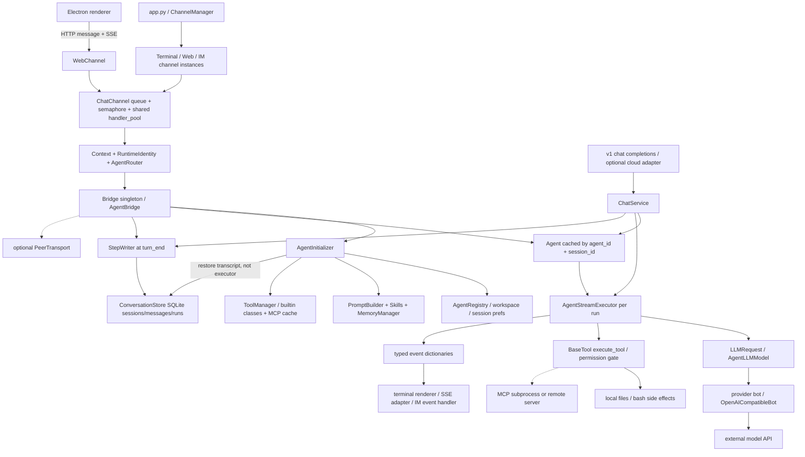

# CowAgent：渠道适配器与 Agent 核心的共享方式

## 0. 研究边界与结论

- 研究日期：2026-10-27。研究票：[研究 CowAgent：渠道适配器与 Agent 核心的共享方式](https://github.com/yyyac/harness/issues/4)。目标是为本地 coding V0 的 CLI 优先、未来 TUI/Web 共享后端、kill 恢复、Trace 与 Agent 评测提供事实，不在这里替产品决定 daemon 拓扑。
- 源仓库：`https://github.com/zhayujie/CowAgent`；通过 `git ls-remote --symref ... HEAD` 确认默认分支 `master`，固定 HEAD **`9b0fac553bf3e8769758f0c9aa2de554c0d69dc5`**，提交时间 `2026-10-26T22:03:01+08:00`。以下源码/测试引用均为该 commit 的 blob，不跟随分支漂移。
- 方法：shallow clone 后仅 git/gh、文件读取与文本检索；未安装依赖、启动源程序、运行测试或操作浏览器。测试结论一律指“测试代码包含这种断言”，不指本次执行通过。已遵从主仓库 `docs/agents/domain.md`；未修改 map/main。
- 流程限制：本后台 investigator 的 `Skill('research')` 因两个同名安装而报歧义，已直接读取技能文件；协调器随后成功加载该技能并确认本会话即后台 investigator，无需嵌套派发。

**总判断：CowAgent 是“进程内共享 Python Agent 核心 + 渠道实例 + 按 Agent/Session 缓存运行时”，另有 Web/桌面 HTTP 客户端和可选外部连接；它不是已证明可直接复用的、具备可靠执行恢复的多 coding 客户端后端。** Web、终端和 IM 最终能走同一 `AgentBridge → Agent → AgentStreamExecutor → model/tools`，但不是所有渠道共用一个 Agent 对象、一个队列或一个 Session；`cow` 管理 CLI 也不是 coding REPL。[S01][S02][S03][S04][S05]

已经实现的有：工具循环、统一事件回调、会话/Run 记录、每个完成步骤增量存储、重启历史重建、页面刷新接续 SSE、确定性 trajectory eval。**没有在所查主链及测试中找到：执行器状态机的持久 Checkpoint、kill 后自动恢复原 Run 的调度循环、外部副作用 exactly-once 或通用去重/对账协议。** 已落盘工具历史与可继续对话，不等于恢复原执行器。[S15][S16][S17][S18][S19][S23][S24][S25]

## 1. 实际入口：先区分“渠道”与“coding 客户端”

| 入口 | 源码实现与边界 | 对本 V0 的含义 |
| --- | --- | --- |
| `python app.py --cmd` | `run()` 把 channels 设为 `terminal`；默认仍可附加 Web。`TerminalChannel.startup()` 使用 `input()`，构造 Context，注入 `TerminalAgentRenderer.handle_event` 后 `produce()`；可显示文本/工具/思考事件。[S01][S06] | 是真实交互终端入口，可使用共享 coding 工具，但不应称其为独立全屏 TUI。 |
| `cow ...` | Click 命令组主要是 start/stop/restart/update/status/logs、skill、knowledge、backup/restore 等管理命令；不是另一个 Agent loop。[S07] | 管理 CLI ≠ coding CLI。不要因项目有 `cli/` 就认定它有独立 coding 会话协议。 |
| Web console | URL 表真实路径为 `/message`、`/poll`、`/stream`、`/cancel`；不是按注释猜成 `/api/message`。MessageHandler 鉴权后委托单例 WebChannel；JSON 请求变为 Context，经通用队列进入 Agent，事件转 SSE，最终 Reply 转 done/轮询结果。[S08][S09][S10] | 真实 Web Agent 入口；与终端复用核心与事件，而不是再实现一套模型循环。 |
| Electron desktop | `python-manager.ts` 启动 bundled backend 或 `app.py` 子进程，设置 `COW_DESKTOP`/端口/token；renderer API client 调 `/message` 与 `/stream`。[S11] | 桌面 UI 与 Python 后端是进程/HTTP 边界，但不是独立远端 Agent 服务的必然证据。 |
| IM | factory 确认微信、公众号/企微、飞书、钉钉、QQ、Telegram、Slack、Discord 等分支。Telegram 的真实 `_on_message → _compose_context → produce` 与 `send → run_coroutine_threadsafe(_async_send)` 可追踪。[S12][S13] | 这些是消息平台适配器，不等于各有项目树、diff、命令权限和开发会话语义的 coding 客户端。 |
| OpenAI-compatible API | URL 表提供 `/v1/chat/completions`；helper `_run_chat_service` 进入 `ChatService.run`，ephemeral 请求关闭持久化并清理会话。它复用 executor，但不是上面的普通 Web Context 路径。[S08][S14] | 同一核心还有第二条服务编排入口；以后统一后端时要检查生命周期/持久化差异，不能只看复用了类。 |

**TUI 检索结论：**检查 tracked 文件入口、`cli/`、`channel/terminal/`、`desktop/` 及关键词后，未找到独立全屏 TUI 应用入口。可正面确认的是 ANSI 终端 renderer + `input()`；不是证明仓库任何角落绝无 TUI。[S06][S07]

## 2. 模块图、职责与直接依赖

箭头表示调用/直接使用；虚线表示可选边界。此图描述源码结构，不表示本次运行观测。

| 模块 | 职责、直接依赖及所有权 |
| --- | --- |
| `app.py / channel_factory` | 读 config/team channel instances，构造渠道对象，每个 startup 在 daemon thread 中运行，管理 stop/restart。默认 Web 自动启动可关闭。依赖 config、plugins、channel registry/factory，不替每个渠道复制模型 loop。[S01][S12] |
| `channel/chat_channel.py` | Context 归一化、插件钩子、每实例输入队列/信号量、进程共享 8 worker handler pool、发送包装。直接依赖 Channel、Dequeue、RuntimeIdentity、plugins。队列不是持久任务日志。[S04][S05][S10] |
| `agent/routing.py / registry` | `agent_id` 显式选择优先于渠道 `bound_agent_id`，否则默认 Agent；profile 给出 workspace/persona 等。注意实现里 bound Agent 不可用时会 log 并 fallback 默认，而显式 unavailable 会抛错；不能只按 docstring 概括成一律拒绝。[S26] |
| `bridge/bridge.py / agent_bridge.py` | Bridge 单例缓存 AgentBridge；后者持有 registry/router、运行时 map、初始化器、取消/steer 与普通回复编排。`create_agent` 构建 AgentLLMModel + Agent，不是把一个全局 Agent 对象发给所有会话。[S02][S03] |
| `bridge/agent_initializer.py` | 按 profile 初始化 workspace、memory、tools、scheduler、skills、PromptBuilder，建立 Agent，绑定默认模型，按 Session 恢复历史。直接依赖这些子系统；这里是组合根，不是纯无状态算法库。[S27] |
| `agent/protocol/agent.py / agent_stream.py` | Agent 保留工具/模型/会话内消息；每次 run_stream 新建 executor。executor 管迭代、上下文裁剪/修复、模型流、工具分发、取消/steer、usage/events。直接依赖 LLMModel/LLMRequest、BaseTool、消息协议与 context helpers。[S15][S16][S28] |
| `AgentLLMModel / models/*` | 把内部请求交给 provider bot 的 `call_with_tools`，传 messages/tools/system/model 与 metadata，适配 provider stream；OpenAICompatibleBot 转内部 Claude-style blocks 为 OpenAI 格式。模型 API 才是实际外部服务边界之一。[S29][S30] |
| `agent/tools/base_tool.py / tool_manager.py` | BaseTool 定义 schema、ToolResult、execute_tool 包装；ToolManager 按 real workspace key 缓存加载状态，内置工具新建实例，MCP 工具可直接返回缓存对象。依赖工具类、配置及 MCP registry。[S31][S32] |
| `agent/memory/conversation_store.py / step_writer.py` | Store 管 SQLite 会话/消息/Run；StepWriter 管某次执行的未写消息 identity 集合，在 turn_end/finish 写闭合片段。不是 checkpoint executor；不与工具外部副作用共事务。[S17][S18][S19][S20] |
| `common/state_dir.py / workspace/session_prefs.py` | 集中解析 shared/per-Agent/per-user 路径；skills、knowledge、MCP、凭据默认共享，Agent 有自己同名路径时优先。session prefs 在 shared root JSON 按 `agent_id::session_id` 存模型/权限/成员；工作目录/偏好与对话 DB 不是同一对象。[S33][S34] |
| `agent/chat/service.py / multiagent/transport.py` | ChatService 是流式 chunk 编排的第二条入口，使用同一运行时和 executor；PeerTransport 是可注入外部 Agent 调用抽象，默认 `_transport=None`，不是普通本地多渠道必须经过的服务。[S14][S35] |

**重要细节：**ToolManager 注释强调“per workspace”，不等于所有 MCP 配置在磁盘上都是独占的；`state_dir.mcp_config_file()` 可能回落 shared root。又因为 MCP 工具可复用缓存对象，不能概括为“所有工具实例均 session-local”。这两层分享需要分开表达。[S31][S32][S33]

## 3. 一条真实请求路径：Web 请求，模型选择 `write` 工具

这是**源码可走通的条件调用链**，不是实跑轨迹。条件：Agent 模式开启、无插件拦截、模型产生有效 write 参数、权限门允许。用一个文件写入来暴露副作用/持久化边界。

1. **启动**：`app.run → ChannelManager.start → channel_factory.create_channel('web') → WebChannel.startup`。其他 IM 可以作为同进程其他线程同时启动。[S01][S12]
2. **输入边界**：`POST /message → MessageHandler.POST`（鉴权）`→ WebChannel.post_message`。读取 `session_id/message/agent_id/attachments/stream`，生成独立 `request_id`，创建 SSEState，构造 WebMessage/Context；Context 带 `receiver/session_id/request_id/agent_id/on_event`，然后新线程调用 `produce(context)`。附件是追加路径引用，不是 executor 自己的 UI 数据结构。[S08][S09]
3. **排队与身份**：`ChatChannel.produce` 调 `AgentBridge.route_context`，用 agent-scoped key 放入此渠道实例的 Dequeue；`consume → _consume_session → handler_pool.submit(_handle)`，默认每 Session 1 个信号量槽位。`_handle` 进入 RuntimeIdentity scope，执行 `_generate_reply → Channel.build_reply_content`。[S04][S05][S10]
4. **进入共享核心**：`Channel.build_reply_content → Bridge.fetch_agent_reply → AgentBridge.agent_reply → get_agent`。运行时缓存 key 为 `(agent_id, session_id)`；冷启动调用 initializer。配置关闭 Agent 时走旧 bot；Agent 异常时 Channel 也会 fallback 普通 bot，因此不能声称每个请求都必经工具 loop。[S02][S03][S10]
5. **Run 与用户消息先落盘**：普通 agent_reply 在执行前 `_begin_run` 建 runs row/ambient run_id，`_pre_persist_user_message` 存用户输入。StepWriter 绑定 executor；在 turn_end **先尝试写步骤，再通知外部事件监听者**，执行结束再 finish。[S18][S36]
6. **Agent/model**：`Agent.run_stream` 复制会话消息，新建 `AgentStreamExecutor` 并绑定 writer。executor 将用户消息追加为内部 content blocks，裁剪/修复后 `while turn < max_turns`，调用 `_call_llm_stream`。后者构造 `LLMRequest(messages, tools, system, stream=True)` 调 `AgentLLMModel.call_stream → bot.call_with_tools`，provider bot 转格式及发模型请求。[S15][S16][S28][S29][S30]
7. **Tool 分发和实际副作用**：模型返回 tool calls；executor 查名称、权限门、失败保护，注入 model/context/cancel/progress callbacks，调用 `BaseTool.execute_tool → Write.execute`。Write 解析路径/父目录、检查内容和 syntax，`write_text_atomic` **先改变文件**，随后才返回 ToolResult。权限拒绝作为普通工具错误回到模型，并不执行 write。[S21][S22][S31]
8. **结果进入下一轮**：executor 把 ToolResult 转成 `tool_result` block，追加到内存 messages；全部工具阶段后 emit turn_end，StepWriter 才尝试把闭合的 tool_use/result 写 SQLite。下一轮模型可读取结果生成最终回答。[S16][S17][S21]
9. **输出边界**：executor emit `{type,timestamp,data}`；`AgentEventHandler` 保留原回调，WebChannel 的 `_make_sse_callback` 把 message_update 映射 delta、工具事件映射卡片并放入有序 SSE log，`GET /stream` 根据 cursor 读取。函数返回的最终 Reply 经 `_decorate_reply/_send_reply → WebChannel.send` 收尾为 done 或 fallback poll。终端则消费同种 Agent 事件并避免重复打印最终文字；Telegram send 最终调平台 API。[S06][S08][S10][S37][S38]

## 4. “共享”到底共享了什么

### 4.1 三层分享，不要混写

1. **共享实现/契约：已实现。** Terminal/Web/IM 都继承 ChatChannel，经 Channel/Bridge 使用同一 Python Agent 核心；内部消息、LLMRequest、工具 schema、事件回调为适配器之间的共同边界。但核心直接引用 conf/logger、memory/skills 等，不能据此说已发布成独立无状态 SDK。[S02][S10][S15][S27][S28]
2. **同一进程中的实例/资源：部分共享。** ChannelManager 启动多个渠道线程；Bridge 单例/AgentBridge map 进程内共享，Agent 是按 `(agent_id, session_id)` 缓存的。不同渠道若落到相同 key，可以取得同一 Agent 对象；默认渠道各自如何造 session_id 仍影响是否真的相同。没有“多渠道自动合并用户身份/会话”的普遍保证。[S01][S02][S03][S13]
3. **客户端到后端/外部服务：另一个边界。** Web browser/desktop renderer 使用 HTTP/SSE；desktop 自己管理 Python 后端子进程；model provider、MCP 和可选 PeerTransport/LinkAI 在进程外。app 中 cloud client 只有配置开关与 deployment id 齐备才启动；常规多渠道不依赖它。不能把“核心在进程内共享”说成“所有入口调用一个远程 Agent 服务”。[S01][S11][S29][S35]

### 4.2 并发与生命周期不能直接搬成多客户端可靠后端

- 输入队列和 semaphore 是 **channel instance-local**，handler_pool 是进程共享；`concurrency_in_session` 默认 1，但可配置改变。此处的串行门不覆盖其他渠道实例的同 key 请求。[S04][S05]
- Agent 的 messages_lock 保护复制和回写，并未覆盖整个 `executor.run_stream`。AgentBridge `_agents_lock` 保护 cache 取建，也不是整个 Run 锁。因此同一个 Agent/Session 被多渠道同时命中时，不能从“每渠道串行”推导出全局 single-writer；这里是静态风险判断，未做并发复现。OpenAI API 另有 64 striped session locks，但不是所有入口共同的锁。[S03][S15][S39]
- `app.py --cmd` 的 terminal EOF/中断走 `_shutdown → os._exit(0)`，结束整个 Python 进程；因此其 CLI 客户端退出并不天然独立于后端生命期。V0 若要求客户端退出后 Run 继续，要另选后台拓扑/断连契约。[S06]
- 渠道关闭/重启、daemon threads、可选模型普通模式 fallback 都是服务部署遗留语义。V0 应在共享应用服务层统一 submit/cancel/steer/subscribe/attach，而不是只让三套 UI import 同一个 Agent 类。[S01][S10]

## 5. Session / Run / Checkpoint / Trace 状态归属

这里沿用地图的工作定义：Session 为持久会话、Run 为一次执行、Checkpoint 为可恢复状态边界、Trace 为诊断记录；**不把源码里 cancellation “checkpoint” 一词当作磁盘快照**。

| 状态 | 实际 owner / 生命周期 | 持久性与约束 |
| --- | --- | --- |
| Agent 配置/身份 | registry profile + workspace；route 后 RuntimeIdentity 绑定 agent/session/run。 | workspace 与 Session 的项目工作目录不是同一个概念；initializer/get_agent 每次应用会话偏好。[S03][S27][S33] |
| Session transcript | `ConversationStore` 的 sessions/messages。逻辑 owner 是 Agent/Session；团队会话 transcript 归 host，speaker 可不同。 | 正常 registry 解析下，多 Agent 对话现在归并到默认 Agent 的 `memory/long-term/index.db`，通过 agent_id 列隔离；默认 Agent 历史用空串。registry 不可用等分支有 legacy per-workspace fallback。不能按文件头旧注释断言每 Agent 独占 DB。[S19][S20][S27] |
| Session runtime | AgentBridge `_agent_instances[(agent_id, session_id)]`；Agent.messages/tools/model、executor copy。 | 进程内；重启后新建并 restore transcript，不保存原 Python 对象/栈/线程。[S03][S15][S27] |
| Session prefs | shared root `session_prefs.json`，key 是 `agent_id::session_id`，provider/model/permission/members。 | 在第一条消息前就可保存，不等 SQLite session row 出现。[S34] |
| Run | 普通 agent_reply `_begin_run/_end_run`；SQLite runs 包含 run_id、session/agent、parent_run_id、task_source、status、时间、error/extras。消息有 run_id，可关联子任务树。[S18][S19][S36] | 建/关 Run 是 best-effort；失败不阻断答复，故不能拿到 done 就认为全链路记录完整。[S36] |
| 第二条 ChatService 路径 | 直接构造同种 executor，自己的 StepWriter/cancel/steer；executor 可生成 ambient run_id。 | 所查 `ChatService.run` 没有普通 Bridge 的 `_begin_run/_end_run` 包装，API helper 直接调用它；有 run_id 或持久消息不自动意味着各入口都建立同等 runs row。其 turn_end 分支先发送 chunk 再 writer.step，顺序也不同于普通 Bridge 的“先存后通知”。应补一致性测试，而非宣称 Run 生命周期统一。[S14][S35][S40][S51] |
| Checkpoint 类似物 | StepWriter 的闭合消息前缀 + SQLite transcript。`_written_ids` 是本次进程中的对象 identity 集合。 | 是已完成步骤的保存边界，不含 pending 工具意图/参数的持久执行状态、外部副作用对账、调度恢复游标。finish 与 step 规则不同，finish 不再等待闭合。[S17][S21] |
| Trace / streaming | executor events → on_event → SSEState/renderer；另有 runs/messages、日志与 HTTP `X-Agent-Run-Id` correlation。 | SSEState/events deque 在内存且有大小/TTL 限制；并非全事件持久 Trace store。transcript 的工具块是部分执行记录，不能代替完整模型请求/所有事件/环境快照。[S23][S37][S38][S41] |
| cancel/steer/queue | CancelTokenRegistry 的 threading.Event、输入队列、活跃执行器。 | 进程内控制状态；cancel 是协作检查，不是外部副作用回滚，也不是 durable scheduler lease。[S04][S05][S24] |

**源码的命名/注释不总是现状：**web handler 注释提到 `/api/message` 而 URL 表是 `/message`；Bridge 的存储方法注释说 workspace-owned，但当前物理 DB 路径已 global；desktop spawn 注释说 no plugins，而 app 的当前实现会后台加载 plugins。报告以可执行分支为准，不以这些注释替代追踪。[S01][S08][S11][S20]

## 6. kill、恢复和副作用不确定窗口

### 6.1 已实现、但范围有限

- **每步增量落盘：**普通路径先存用户消息；工具阶段结束 turn_end 时 StepWriter 存尚未记录、且 tool_use/result 已闭合的消息，末尾 finish。一次暂时写库失败保持 pending，可在下一次 flush 再试。写入是 best-effort，错误记录后不会自动停住执行器。[S17][S18]
- **重启后重建上下文：**initializer 按会话载入一段历史，solo 用 `cut_off=True`；近期保留经裁剪的工具链，旧 turn 退化为文本。未完成 turn 追加 Interrupted 说明；没有 result 的尾部 tool call 可被丢弃，说明只概括其保留下来的历史。不是从同一 program counter 继续。[S27][S42]
- **运行状态展示：**持久 row 仍标 running，但不在当前进程 `_live_runs` 集合时，history 视为 interrupted；这是读模型解释，不是自动重启原 Run 或重放工具。[S19][S25]
- **页面刷新/网络重连：**SSE 有 seq/Last-Event-ID，stored_seq 与 stored_event_seq 对齐；页面可先渲染已存 transcript 再接剩余事件。但这些 request→stream 映射/deque 在 RAM；Python 被 kill 后不存在可续读的原内存流。[S08][S23][S37]

### 6.2 工具已生效但结果未写：关键窗口

| 中断位置 | 从源码能推断什么 | 不应承诺什么 |
| --- | --- | --- |
| 用户消息已写，模型还没给结果 | Session/Run 可显示未完成；用户输入可在下一次重建历史里出现。[S18][S19] | 不能保证原请求自动再次运行。 |
| `Write.execute` 已完成 `write_text_atomic`，ToolResult 尚未返回 | 文件可能已变；没有工具结果写库，更无与文件操作同事务的消息记录。[S21][S22] | “恢复后没看见成功结果，所以可以安全重试”不成立。 |
| tool execution_end 已推给 UI，尚未 tool_result 入内存/turn_end commit | UI 可能曾显示成功，磁盘 transcript 仍缺这一步。一次 turn 多工具时，先完成工具也要等整个工具阶段后的 flush；放大未落盘窗口。[S16][S21] | SSE 已收到不等于结果 durable；静态工具调用去重提示不能提供 exactly-once。 |
| tool_use/result 已在 SQLite，最后答案还没完成 | 重建可保留已完成链并加入中断提示，让后续模型参考；最近历史仍有裁剪/窗口限制。[S17][S27][S42] | 不是可验证的“不再重复执行”协议，提示词不是副作用 ledger。 |
| 并行工具收到 cancel | parallel_safe worker 用复制工具和 contextvars 启动；取消时等待方返回 discarded error，pool.shutdown(wait=False)。worker 可仍未结束。[S43] | cancel acknowledgment 不等于所有 subprocess/外部动作已经停止或回滚。 |
| DB 写失败而执行继续 | StepWriter 后续可重试，但若进程在成功 flush 前死去，pending identity 集合也丢失。[S17][S44] | best-effort 保存不是 durable write barrier。 |

源码中 write 使用原子文件 helper 只解决文件更新自身的一部分完整性，**不连接 SQLite 的提交**；这里不把原子改名扩大解释成跨文件/外部 API 的事务。现有恢复提示甚至会说“these calls really ran”，但对“已执行却没写下来的调用”无法据此确认；缺失记录必须在 V0 表达成 unknown，而不是擅自判定未执行。[S22][S42]

本次未找到自动 scan interrupted Run 后恢复 executor、持久 pending effect/outbox、通用 idempotency key 或外部结果 reconciliation 实现。这个负面结论的范围是所读 `agent/protocol`、Bridge/ChatService、conversation store、channels 和相关恢复测试，**不等于对外部 MCP 服务或任意插件作完备证明**。

### 6.3 测试证据能证明到哪一层

- `test_incremental_persist.py` 测闭合前缀、对象 identity、失败重试；还用真实 AgentStreamExecutor loop 配脚本 model/tool，测试每条存一次。Bridge fixture 覆盖异常保留步骤、先存再 turn_end；不是 OS kill 注入。[S45]
- `test_bridge_step_write_retry.py` 注入 sqlite locked 与提交后 artifact index 错误，检查消息不重复。这支持“进程内 flush retry”设计，但不是重启后的 effect 去重证明。[S44]
- `test_resume_after_reload.py` 通过 `_live_runs.discard` 模拟进程消失，并造内存 SSE state 测重连；`test_restore_tool_chains.py` 通过 Store→Initializer 重建工具链。这些是有价值的恢复/重建测试，**不是实杀进程、真实 write/bash 副作用中断后续跑的测试**。[S25][S46]
- 特别避免误读 `test_session_resurrect.py`：它测删除会话后异步回复不得把会话复活，不是断电恢复功能。

## 7. Trace 与 Agent eval：有实际代码，但不是完整可靠执行证据

### 7.1 Trace

executor 统一回调事件 `{type,timestamp,data}`，包括 agent/turn/message/tool/error 等；tool start/end 有 id/name/arguments/status/result/time；原始回调异常只记日志。Web 再转换并裁剪展示内容：思考显示上限为 4K，SSE deque 上限 5000 事件/4MiB，且有 TTL。`apply_client_source` 可把 ambient run_id 送作 `X-Agent-Run-Id`。这些足以借鉴统一事件与 correlation，但不是已证明覆盖“每 Run 全链路”的持久 Trace 系统。[S21][S23][S37][S38][S41]

Run/message DB 能保存工具调用链与部分 usage，并有 parent_run_id/task 来源；它与所有原始事件不是一一对应。没有在所查主链看到 OpenTelemetry/Langfuse/LangSmith 的全 span 导出，也未找到一个保证模型请求、工具 intent/result、cancel、持久化失败都写入同一 durable Trace journal 的实现。这里不否定日志诊断价值，只拒绝把 UI 回放、reasoning 文本、conversation transcript 都叫同一种恢复级 Trace。[S17][S19][S36][S38]

### 7.2 真正 Agent trajectory eval

`tests/trajectory_eval.py` 明确是 test-only 的 deterministic helper；TrajectoryRecorder 收集 callback，计算 final_status/turn_count/tool_call_count/success/fail/selected_tools/error/duration/final_response，run_eval_case 捕获异常形成结果。不是依赖 README 的口号。[S47]

`test_trajectory_eval.py` 用 `_ScriptedExecutor(AgentStreamExecutor)`，只脚本化模型、保留真实 loop 与工具 wrapper；断言直接回答无工具、成功工具、工具业务失败但 Run 仍 done、未完成事件 incomplete。这是**确定性轨迹回归**，没有证明真实模型 coding 任务成功率、补丁正确性、仓库测试通过率或 kill 恢复成功率；EvalCase 的 expected 字段也不是自动 judge，测试里仍需显式 assert。[S48]

另一个名字带 eval 的 `test_tool_path_and_eval.py` 实际含 browser JavaScript evaluate 的包装测试，不是 Agent 评测，不能凑数。CI 配置确实运行 backend pytest suite（3.11/3.13），但本次没执行，也没核验固定 commit 的 CI 结果，不能报告“测试全绿”。[S49][S50]

## 8. 对本地 coding V0 的建议与缺口

以下是**基于证据的设计建议，不是替 V0 关闭产品决策**。

| 建议 | 借鉴/拒绝照搬的依据 | V0 仍需规定 |
| --- | --- | --- |
| 先定义共享应用服务和事件契约，CLI 只做适配 | Channel/Bridge 复用同一 loop、LLMRequest/tools/event callback 已有正例；Web 与 ChatService 双编排又展示生命周期漂移风险。[S10][S14][S15][S28] | submit Run、attach Session、subscribe event cursor、cancel/steer 的统一边界；CLI/TUI/Web 是否同连、daemon 是否必需。 |
| 区分 Session/Run/request，不拿 UI request_id 当持久 Run | CowAgent 普通路径有独立 Run row、parent/task 关系；SSE request 有不同 RAM 生命周期。[S18][S23][S36] | stable Run id、跨重连身份、每 Session 全入口 single-writer/排队策略、Run 状态机。 |
| 保留 per-step 存储，升级为 durable checkpoint/effect 协议 | StepWriter 及时保存闭合工具链明显优于整次结束才保存；但 write 先外部生效、turn_end 后写库的窗口真实存在。[S17][S21][S22] | before-call intent、after-call result、checkpoint version、unknown effect、重试/人工确认/只读对账规则；不得默认重放任意 bash。 |
| 从测试驱动恢复语义，不靠“继续执行”提示词 | 当前测试覆盖静态重建与进程内错误；没有实杀副作用边界的验收证据。[S25][S44][S45][S46] | kill 在 call 前、effect 后/result 前、DB 后/UI 前；验证输出可恢复且副作用不盲重放，故障夹具不能改真实用户仓库。 |
| Trace 与 Checkpoint 分开，允许相互关联 | CowAgent 有统一事件/correlation，但 SSE 有限且内存，Store 是 transcript 而非全事件 journal。[S23][S37][S41] | durable ordered events、run/tool-call correlation、敏感字段脱敏、模型请求/结果与权限/错误记录；Trace 丢失是否阻断 Run。 |
| eval 从 deterministic loop 回归起步，再加 coding outcome | TrajectoryRecorder 可立即借鉴，但 selected_tools/成功次数不能等价于任务完成。[S47][S48] | fixture repo、期望 patch/测试结果、工具拒绝/失败、预算、取消、kill recovery、unknown-effect 人工接管评测。 |
| 默认串行副作用工具，取消语义明示 | BaseTool parallel_safe 默认 false，permission gate per-call；parallel cancel 不等待全部 worker。[S21][S31][S43] | 工具 effect 类型、超时与子进程归属、确认模式、取消后是否仍有在途副作用；本票不替用户选权限策略。 |
| 明确共享资源与隔离边界 | registry/workspace state、global conversation DB agent_id、shared skills/MCP 与 per-session runtime 不是同一种共享。[S03][S20][S32][S33] | 配置、凭据、工具运行实例、工作目录、会话/用户隔离及并发锁；不要照搬隐式全局状态。 |

**最终适配评价：**非常值得借鉴“薄渠道适配器 + 单一工具循环 + provider adapter + 统一事件 + 分步保存/确定性轨迹测试”；不宜原样当成“CLI/TUI/Web 独立连接、kill 后自动恢复、每次运行全链路 durable trace、工具效果可靠去重”均已完成的样板。该项目的 IM 服务功能、多 Agent/Memory/Skills/云接入范围远大于 CLI 优先 coding V0，宜抽取边界而非搬整套服务。[S01][S15][S17][S47]

## 9. 证据索引（全部固定源 commit）

以下行号紧贴被引用实现/断言；负面结论另在正文限定检索范围。README 只用来标记宣称，不作实现替代。

[S01]: https://github.com/zhayujie/CowAgent/blob/9b0fac553bf3e8769758f0c9aa2de554c0d69dc5/app.py#L794-L855
[S02]: https://github.com/zhayujie/CowAgent/blob/9b0fac553bf3e8769758f0c9aa2de554c0d69dc5/bridge/bridge.py#L174-L198
[S03]: https://github.com/zhayujie/CowAgent/blob/9b0fac553bf3e8769758f0c9aa2de554c0d69dc5/bridge/agent_bridge.py#L1230-L1294
[S04]: https://github.com/zhayujie/CowAgent/blob/9b0fac553bf3e8769758f0c9aa2de554c0d69dc5/channel/chat_channel.py#L23-L43
[S05]: https://github.com/zhayujie/CowAgent/blob/9b0fac553bf3e8769758f0c9aa2de554c0d69dc5/channel/chat_channel.py#L668-L703
[S06]: https://github.com/zhayujie/CowAgent/blob/9b0fac553bf3e8769758f0c9aa2de554c0d69dc5/channel/terminal/terminal_channel.py#L330-L386
[S07]: https://github.com/zhayujie/CowAgent/blob/9b0fac553bf3e8769758f0c9aa2de554c0d69dc5/cli/cli.py#L49-L82
[S08]: https://github.com/zhayujie/CowAgent/blob/9b0fac553bf3e8769758f0c9aa2de554c0d69dc5/channel/web/web_channel.py#L87-L124
[S09]: https://github.com/zhayujie/CowAgent/blob/9b0fac553bf3e8769758f0c9aa2de554c0d69dc5/channel/web/core/channel.py#L1131-L1198
[S10]: https://github.com/zhayujie/CowAgent/blob/9b0fac553bf3e8769758f0c9aa2de554c0d69dc5/channel/channel.py#L151-L182
[S11]: https://github.com/zhayujie/CowAgent/blob/9b0fac553bf3e8769758f0c9aa2de554c0d69dc5/desktop/src/main/python-manager.ts#L773-L807
[S12]: https://github.com/zhayujie/CowAgent/blob/9b0fac553bf3e8769758f0c9aa2de554c0d69dc5/channel/channel_factory.py#L54-L105
[S13]: https://github.com/zhayujie/CowAgent/blob/9b0fac553bf3e8769758f0c9aa2de554c0d69dc5/channel/telegram/telegram_channel.py#L376-L390
[S14]: https://github.com/zhayujie/CowAgent/blob/9b0fac553bf3e8769758f0c9aa2de554c0d69dc5/channel/web/api/openai_compat.py#L697-L707
[S15]: https://github.com/zhayujie/CowAgent/blob/9b0fac553bf3e8769758f0c9aa2de554c0d69dc5/agent/protocol/agent.py#L815-L844
[S16]: https://github.com/zhayujie/CowAgent/blob/9b0fac553bf3e8769758f0c9aa2de554c0d69dc5/agent/protocol/agent_stream.py#L1130-L1151
[S17]: https://github.com/zhayujie/CowAgent/blob/9b0fac553bf3e8769758f0c9aa2de554c0d69dc5/agent/protocol/step_writer.py#L28-L106
[S18]: https://github.com/zhayujie/CowAgent/blob/9b0fac553bf3e8769758f0c9aa2de554c0d69dc5/bridge/agent_bridge.py#L1712-L1787
[S19]: https://github.com/zhayujie/CowAgent/blob/9b0fac553bf3e8769758f0c9aa2de554c0d69dc5/agent/memory/conversation_store.py#L1541-L1561
[S20]: https://github.com/zhayujie/CowAgent/blob/9b0fac553bf3e8769758f0c9aa2de554c0d69dc5/agent/memory/conversation_store.py#L2789-L2829
[S21]: https://github.com/zhayujie/CowAgent/blob/9b0fac553bf3e8769758f0c9aa2de554c0d69dc5/agent/protocol/agent_stream.py#L2371-L2427
[S22]: https://github.com/zhayujie/CowAgent/blob/9b0fac553bf3e8769758f0c9aa2de554c0d69dc5/agent/tools/write/write.py#L67-L114
[S23]: https://github.com/zhayujie/CowAgent/blob/9b0fac553bf3e8769758f0c9aa2de554c0d69dc5/channel/web/core/_common.py#L94-L111
[S24]: https://github.com/zhayujie/CowAgent/blob/9b0fac553bf3e8769758f0c9aa2de554c0d69dc5/agent/protocol/cancel.py#L35-L93
[S25]: https://github.com/zhayujie/CowAgent/blob/9b0fac553bf3e8769758f0c9aa2de554c0d69dc5/tests/test_resume_after_reload.py#L58-L81
[S26]: https://github.com/zhayujie/CowAgent/blob/9b0fac553bf3e8769758f0c9aa2de554c0d69dc5/agent/routing.py#L51-L78
[S27]: https://github.com/zhayujie/CowAgent/blob/9b0fac553bf3e8769758f0c9aa2de554c0d69dc5/bridge/agent_initializer.py#L157-L214
[S28]: https://github.com/zhayujie/CowAgent/blob/9b0fac553bf3e8769758f0c9aa2de554c0d69dc5/agent/protocol/agent_stream.py#L1646-L1668
[S29]: https://github.com/zhayujie/CowAgent/blob/9b0fac553bf3e8769758f0c9aa2de554c0d69dc5/bridge/agent_bridge.py#L503-L567
[S30]: https://github.com/zhayujie/CowAgent/blob/9b0fac553bf3e8769758f0c9aa2de554c0d69dc5/models/openai_compatible_bot.py#L89-L113
[S31]: https://github.com/zhayujie/CowAgent/blob/9b0fac553bf3e8769758f0c9aa2de554c0d69dc5/agent/tools/base_tool.py#L168-L191
[S32]: https://github.com/zhayujie/CowAgent/blob/9b0fac553bf3e8769758f0c9aa2de554c0d69dc5/agent/tools/tool_manager.py#L788-L809
[S33]: https://github.com/zhayujie/CowAgent/blob/9b0fac553bf3e8769758f0c9aa2de554c0d69dc5/common/state_dir.py#L119-L169
[S34]: https://github.com/zhayujie/CowAgent/blob/9b0fac553bf3e8769758f0c9aa2de554c0d69dc5/agent/workspace/session_prefs.py#L1-L26
[S35]: https://github.com/zhayujie/CowAgent/blob/9b0fac553bf3e8769758f0c9aa2de554c0d69dc5/agent/chat/service.py#L103-L167
[S36]: https://github.com/zhayujie/CowAgent/blob/9b0fac553bf3e8769758f0c9aa2de554c0d69dc5/bridge/agent_bridge.py#L1131-L1190
[S37]: https://github.com/zhayujie/CowAgent/blob/9b0fac553bf3e8769758f0c9aa2de554c0d69dc5/channel/web/core/channel.py#L582-L641
[S38]: https://github.com/zhayujie/CowAgent/blob/9b0fac553bf3e8769758f0c9aa2de554c0d69dc5/channel/web/core/channel.py#L322-L371
[S39]: https://github.com/zhayujie/CowAgent/blob/9b0fac553bf3e8769758f0c9aa2de554c0d69dc5/channel/web/api/openai_compat.py#L347-L349
[S40]: https://github.com/zhayujie/CowAgent/blob/9b0fac553bf3e8769758f0c9aa2de554c0d69dc5/agent/chat/service.py#L402-L436
[S41]: https://github.com/zhayujie/CowAgent/blob/9b0fac553bf3e8769758f0c9aa2de554c0d69dc5/common/utils.py#L293-L322
[S42]: https://github.com/zhayujie/CowAgent/blob/9b0fac553bf3e8769758f0c9aa2de554c0d69dc5/bridge/agent_initializer.py#L476-L518
[S43]: https://github.com/zhayujie/CowAgent/blob/9b0fac553bf3e8769758f0c9aa2de554c0d69dc5/agent/protocol/agent_stream.py#L2196-L2245
[S44]: https://github.com/zhayujie/CowAgent/blob/9b0fac553bf3e8769758f0c9aa2de554c0d69dc5/tests/test_bridge_step_write_retry.py#L14-L60
[S45]: https://github.com/zhayujie/CowAgent/blob/9b0fac553bf3e8769758f0c9aa2de554c0d69dc5/tests/test_incremental_persist.py#L439-L470
[S46]: https://github.com/zhayujie/CowAgent/blob/9b0fac553bf3e8769758f0c9aa2de554c0d69dc5/tests/test_restore_tool_chains.py#L187-L217
[S47]: https://github.com/zhayujie/CowAgent/blob/9b0fac553bf3e8769758f0c9aa2de554c0d69dc5/tests/trajectory_eval.py#L39-L115
[S48]: https://github.com/zhayujie/CowAgent/blob/9b0fac553bf3e8769758f0c9aa2de554c0d69dc5/tests/test_trajectory_eval.py#L90-L145
[S49]: https://github.com/zhayujie/CowAgent/blob/9b0fac553bf3e8769758f0c9aa2de554c0d69dc5/tests/test_tool_path_and_eval.py#L47-L86
[S50]: https://github.com/zhayujie/CowAgent/blob/9b0fac553bf3e8769758f0c9aa2de554c0d69dc5/.github/workflows/test.yml#L8-L39
[S51]: https://github.com/zhayujie/CowAgent/blob/9b0fac553bf3e8769758f0c9aa2de554c0d69dc5/agent/chat/service.py#L343-L357

### 补充紧邻实现证据

- Bridge 单例与其持有的状态：[单例声明](https://github.com/zhayujie/CowAgent/blob/9b0fac553bf3e8769758f0c9aa2de554c0d69dc5/bridge/bridge.py#L12-L14)、[AgentBridge cache/lock](https://github.com/zhayujie/CowAgent/blob/9b0fac553bf3e8769758f0c9aa2de554c0d69dc5/bridge/agent_bridge.py#L593-L614)。
- ChannelManager 进程内线程启动：[start](https://github.com/zhayujie/CowAgent/blob/9b0fac553bf3e8769758f0c9aa2de554c0d69dc5/app.py#L220-L237)、[threads](https://github.com/zhayujie/CowAgent/blob/9b0fac553bf3e8769758f0c9aa2de554c0d69dc5/app.py#L282-L293)、[可选 cloud client](https://github.com/zhayujie/CowAgent/blob/9b0fac553bf3e8769758f0c9aa2de554c0d69dc5/app.py#L244-L268)。
- queue 路由/参数：[produce](https://github.com/zhayujie/CowAgent/blob/9b0fac553bf3e8769758f0c9aa2de554c0d69dc5/channel/chat_channel.py#L542-L550)、[semaphore 与入队](https://github.com/zhayujie/CowAgent/blob/9b0fac553bf3e8769758f0c9aa2de554c0d69dc5/channel/chat_channel.py#L581-L590)、[_handle identity/发出回复](https://github.com/zhayujie/CowAgent/blob/9b0fac553bf3e8769758f0c9aa2de554c0d69dc5/channel/chat_channel.py#L191-L235)。
- Web 鉴权/SSE 游标：[handler](https://github.com/zhayujie/CowAgent/blob/9b0fac553bf3e8769758f0c9aa2de554c0d69dc5/channel/web/api/chat.py#L24-L63)、[JSON 输入](https://github.com/zhayujie/CowAgent/blob/9b0fac553bf3e8769758f0c9aa2de554c0d69dc5/channel/web/core/channel.py#L1020-L1038)、[最终 send](https://github.com/zhayujie/CowAgent/blob/9b0fac553bf3e8769758f0c9aa2de554c0d69dc5/channel/web/core/channel.py#L163-L185)、[有界事件 deque](https://github.com/zhayujie/CowAgent/blob/9b0fac553bf3e8769758f0c9aa2de554c0d69dc5/channel/web/core/channel.py#L47-L54)、[裁剪实现](https://github.com/zhayujie/CowAgent/blob/9b0fac553bf3e8769758f0c9aa2de554c0d69dc5/channel/web/core/channel.py#L102-L129)。
- 终端/桌面/IM 输出：[renderer 事件](https://github.com/zhayujie/CowAgent/blob/9b0fac553bf3e8769758f0c9aa2de554c0d69dc5/channel/terminal/terminal_channel.py#L94-L151)、[避免重复文字](https://github.com/zhayujie/CowAgent/blob/9b0fac553bf3e8769758f0c9aa2de554c0d69dc5/channel/terminal/terminal_channel.py#L268-L277)、[desktop message](https://github.com/zhayujie/CowAgent/blob/9b0fac553bf3e8769758f0c9aa2de554c0d69dc5/desktop/src/renderer/src/api/client.ts#L261-L304)、[desktop SSE](https://github.com/zhayujie/CowAgent/blob/9b0fac553bf3e8769758f0c9aa2de554c0d69dc5/desktop/src/renderer/src/api/client.ts#L325-L334)、[Telegram send](https://github.com/zhayujie/CowAgent/blob/9b0fac553bf3e8769758f0c9aa2de554c0d69dc5/channel/telegram/telegram_channel.py#L572-L590)。
- 补充已复核的发送/文件边界：[provider HTTP client 调用](https://github.com/zhayujie/CowAgent/blob/9b0fac553bf3e8769758f0c9aa2de554c0d69dc5/models/openai_compatible_bot.py#L350-L369)、[AgentEventHandler 转交原回调](https://github.com/zhayujie/CowAgent/blob/9b0fac553bf3e8769758f0c9aa2de554c0d69dc5/bridge/agent_event_handler.py#L35-L55)、[Web 最终 done/stream_end](https://github.com/zhayujie/CowAgent/blob/9b0fac553bf3e8769758f0c9aa2de554c0d69dc5/channel/web/core/channel.py#L240-L275)、[atomic helper flush/fsync/replace 及 fallback](https://github.com/zhayujie/CowAgent/blob/9b0fac553bf3e8769758f0c9aa2de554c0d69dc5/common/atomic_write.py#L58-L79)。
- executor loop/持久化窗口：[每轮调用模型](https://github.com/zhayujie/CowAgent/blob/9b0fac553bf3e8769758f0c9aa2de554c0d69dc5/agent/protocol/agent_stream.py#L990-L1006)、[结果写内存](https://github.com/zhayujie/CowAgent/blob/9b0fac553bf3e8769758f0c9aa2de554c0d69dc5/agent/protocol/agent_stream.py#L1219-L1239)、[turn_end](https://github.com/zhayujie/CowAgent/blob/9b0fac553bf3e8769758f0c9aa2de554c0d69dc5/agent/protocol/agent_stream.py#L1284-L1289)、[权限拒绝](https://github.com/zhayujie/CowAgent/blob/9b0fac553bf3e8769758f0c9aa2de554c0d69dc5/agent/protocol/agent_stream.py#L2291-L2321)、[event callback best-effort](https://github.com/zhayujie/CowAgent/blob/9b0fac553bf3e8769758f0c9aa2de554c0d69dc5/agent/protocol/agent_stream.py#L552-L562)。
- Store/restore：[按事务 append + run_id](https://github.com/zhayujie/CowAgent/blob/9b0fac553bf3e8769758f0c9aa2de554c0d69dc5/agent/memory/conversation_store.py#L831-L899)、[create_run](https://github.com/zhayujie/CowAgent/blob/9b0fac553bf3e8769758f0c9aa2de554c0d69dc5/agent/memory/conversation_store.py#L1405-L1450)、[finish_run](https://github.com/zhayujie/CowAgent/blob/9b0fac553bf3e8769758f0c9aa2de554c0d69dc5/agent/memory/conversation_store.py#L1454-L1504)、[global scoped handle](https://github.com/zhayujie/CowAgent/blob/9b0fac553bf3e8769758f0c9aa2de554c0d69dc5/agent/memory/conversation_store.py#L2858-L2886)、[载入窗口/solo cut_off](https://github.com/zhayujie/CowAgent/blob/9b0fac553bf3e8769758f0c9aa2de554c0d69dc5/bridge/agent_initializer.py#L272-L310)、[中断提示原文](https://github.com/zhayujie/CowAgent/blob/9b0fac553bf3e8769758f0c9aa2de554c0d69dc5/bridge/agent_initializer.py#L52-L70)。
- 分享边界：[ToolManager cache key](https://github.com/zhayujie/CowAgent/blob/9b0fac553bf3e8769758f0c9aa2de554c0d69dc5/agent/tools/tool_manager.py#L31-L60)、[parallel_safe 默认](https://github.com/zhayujie/CowAgent/blob/9b0fac553bf3e8769758f0c9aa2de554c0d69dc5/agent/tools/base_tool.py#L96-L108)、[可选 peer transport](https://github.com/zhayujie/CowAgent/blob/9b0fac553bf3e8769758f0c9aa2de554c0d69dc5/agent/multiagent/transport.py#L158-L188)、[Agent 执行后 messages 回写](https://github.com/zhayujie/CowAgent/blob/9b0fac553bf3e8769758f0c9aa2de554c0d69dc5/agent/protocol/agent.py#L855-L894)。
- 更多测试定位：[StepWriter pending/retry](https://github.com/zhayujie/CowAgent/blob/9b0fac553bf3e8769758f0c9aa2de554c0d69dc5/tests/test_incremental_persist.py#L63-L84)、[真实 loop + scripted responses](https://github.com/zhayujie/CowAgent/blob/9b0fac553bf3e8769758f0c9aa2de554c0d69dc5/tests/test_incremental_persist.py#L172-L233)、[restore interrupted 工具链](https://github.com/zhayujie/CowAgent/blob/9b0fac553bf3e8769758f0c9aa2de554c0d69dc5/tests/test_resume_after_reload.py#L136-L171)、[删除会话不得复活](https://github.com/zhayujie/CowAgent/blob/9b0fac553bf3e8769758f0c9aa2de554c0d69dc5/tests/test_session_resurrect.py#L21-L50)、[eval scripted executor](https://github.com/zhayujie/CowAgent/blob/9b0fac553bf3e8769758f0c9aa2de554c0d69dc5/tests/test_trajectory_eval.py#L34-L70)、[eval runner](https://github.com/zhayujie/CowAgent/blob/9b0fac553bf3e8769758f0c9aa2de554c0d69dc5/tests/trajectory_eval.py#L118-L129)、[cancel 不等慢 worker 测试](https://github.com/zhayujie/CowAgent/blob/9b0fac553bf3e8769758f0c9aa2de554c0d69dc5/tests/test_parallel_tool_cancel.py#L57-L68)。

## 10. 宣称、实现、未找到清单

| 层次 | 本报告处理 |
| --- | --- |
| README 宣称 | [Highlights L48-L60](https://github.com/zhayujie/CowAgent/blob/9b0fac553bf3e8769758f0c9aa2de554c0d69dc5/README.md#L48-L60) 宣称 Planning、Multi-Agent、Memory、Evolution、Tools、Channels、Models 等；不据此宣称 coding outcome、可靠恢复或完整 tracing。 |
| 源码已实现 | 已定位渠道适配/组合根/按会话运行时、实际工具循环及分发、per-step conversation persistence、Run row、历史恢复与 SSE 接续、deterministic trajectory tests，见上面固定证据。 |
| 未找到/不充分 | 独立全屏 TUI、跨所有入口的全局 Session Run 排他契约、durable executor Checkpoint、kill 后自动恢复原 Run、外部副作用对账/通用去重、每 Run 全链路 durable Trace、真实 coding benchmark/恢复 fault-injection 验收。只作为指定范围的研究缺口，不宣称仓库所有插件/外部服务绝无该能力。 |
| 未验证 | 源程序可启动性、平台/模型兼容性、测试通过率、真实网络重连、OS kill 后恢复、工具副作用是否重复。静态源码和测试阅读均不替代这些验收。 |
