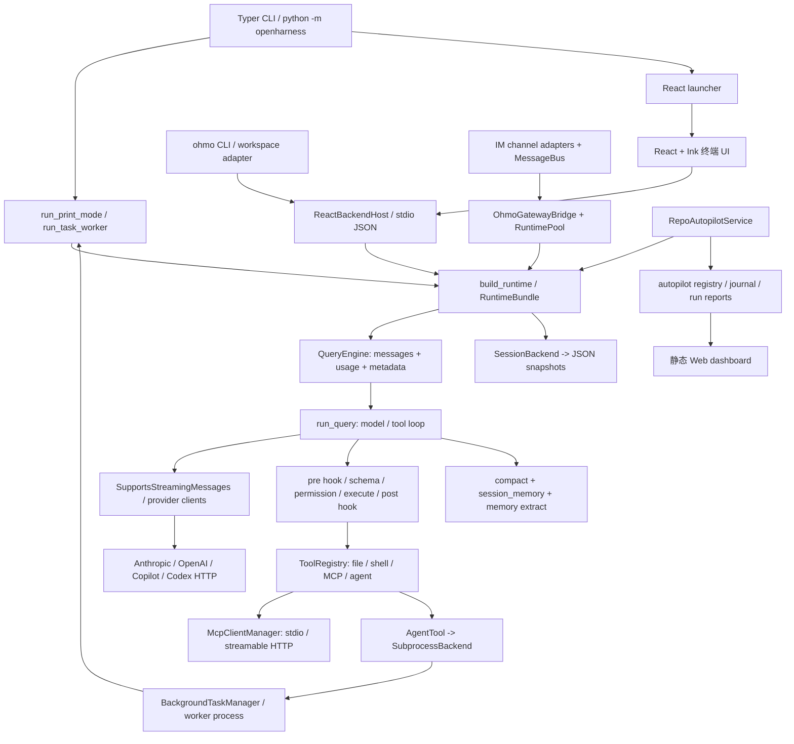

# OpenHarness：执行内核、恢复与可观测性边界

- 研究日期：2026-10-27。
- 研究票：[研究 OpenHarness：执行内核、恢复与可观测性边界](https://github.com/yyyac/harness/issues/3)。
- 上游：[HKUDS/OpenHarness](https://github.com/HKUDS/OpenHarness)，默认分支 `main`；研究时 `origin/HEAD`、`refs/heads/main` 和远程 HEAD 均为 **`9b2efd795c6aa09f88b0c257d269a9e518da6ae7`**（提交时间 2026-06-04T02:42:36Z）。下列所有源码链接均固定到该 commit，不跟随 main。
- 方法：shallow clone 后静态阅读 Python/TypeScript 主执行路径、入口、存储、任务、通信、测试与 CI；未安装依赖、未运行目标仓库程序或测试、未操作浏览器、未做 kill/断电实验。本文的“已实现”仅指存在可追踪代码，不代表本次实测通过。
- 结论等级：**源码已实现**、**文档宣称**、**静态推断**、**未找到**。负面结论限于本次检查范围，不能证明所有外部部署都没有该能力。

## 1. 结论先行

1. **源码已实现：自有 Agent loop，而非外部 Agent CLI 的薄包装。** `run_query` 自己请求模型、解析统一消息、派发工具、将结果送回模型；Codex/Claude 订阅属于认证和模型传输路径，不等于把决策交给它们的 CLI。[模型调用][query-model]、[工具循环][query-tools]、[Codex HTTP][codex-http]。
2. **源码已实现：共享的是 Python RuntimeBundle/QueryEngine，不是一个常驻、统一持久化的多端 Agent server。** CLI、React/Ink TUI、worker、ohmo 复用内核，但 transport、生命周期、session 存储可以不同。[runtime 构建][runtime-build]、[ohmo 注入][ohmo-backend]。
3. **源码已实现：会话恢复是整份 JSON 对话快照。** 不是事件溯源、不是工具级 durable execution；`compact_checkpoints` 是压缩阶段元数据，session memory 是摘要 Markdown。[快照][snapshot-write]、[compact checkpoint][compact-checkpoint]、[session memory][session-memory]。
4. **静态推断：有工具已生效、结果尚未持久化的明确窗口。** 工具 `execute` 先发生，结果随后进入对话，外层通常在整个输入完成后才保存；没有在该路径找到执行意图/结果 WAL、幂等键或副作用对账机制。[工具调用边界][tool-execute]、[结果入历史][query-tools]、[保存时机][runtime-save]。
5. **源码已实现但能力有限：后台 Agent“restart”是新进程，不保留之前交互上下文。** manager 的 task/process 索引在内存，日志在磁盘；源码与测试直接写明丢上下文。[重启][task-restart]、[对应测试][test-task-restart]。
6. **静态发现：CLI `--continue/--resume` 到默认 React TUI 的恢复参数断链。** CLI 读取 snapshot 并传给 `run_repl`，但 `run_repl` 只在 backend-only 分支转发，默认 launcher 调用没有这些参数。不能把存储单测当成整个 CLI/TUI 恢复已验证。[CLI 恢复][cli-resume]、[run_repl 分支][repl]。
7. **源码已实现：流事件、debug 日志、对话导出、工具大输出工件和 autopilot journal；未找到统一 durable trace/span 系统。** README 的 “full observability” 应降解为这些具体机制，而非推断已有完整可回放追踪。[事件][stream-events]、[输出工件][tool-artifact]、[journal][autopilot-journal]、[README 宣称][readme-loop]。
8. **源码已实现：有 fake-client 回归测试与 real-provider Agent 场景脚本，但本次没有任何评测运行结果。** 后者不少是 `task_*` + 自定义 `main()`，不等同于常规 pytest 自动执行，更不是 kill 恢复测试。[真实场景驱动][real-driver]、[CI][ci]。

## 2. 模块图与直接依赖

以下箭头表示代码调用或构建依赖，不表示独立微服务或持久化保障。图的证据见后续模块表与入口链。



| 模块/职责 | 直接依赖与边界 | 固定源码证据 |
|---|---|---|
| `cli.py` / `ui.app`：参数、模式分流 | Typer；run_repl / print / worker；CLI 自己做 snapshot 选择 | [console scripts][scripts]、[模式分流][cli-modes]、[恢复][cli-resume] |
| `react_launcher` / terminal frontend：终端展示与后端进程启动 | Python launcher → tsx → Ink；Node child_process/readline；stdin JSON 与 `OHJSON:` stdout；不是浏览器 React app | [launcher][react-launch]、[frontend 入口][ink-entry]、[spawn/protocol][frontend-protocol] |
| `ReactBackendHost`：请求队列、modal future、取消、流事件转换 | build/start/close_runtime、handle_line、task snapshots；仍由本地 Python 进程拥有运行状态 | [构建与分发][host-run]、[处理输入][host-handle]、[取消][host-cancel] |
| `ui.runtime`：composition root | Settings、plugins、MCP manager、ToolRegistry、PermissionChecker、HookExecutor、commands、SessionBackend、QueryEngine | [构建][runtime-build]、[engine 注入][runtime-engine]、[bundle 返回][runtime-bundle] |
| `QueryEngine`：对话与 token usage owner | api protocol、tool registry、permission/hooks、run_query；`load_messages` 只换 history | [所有权][engine-owner]、[提交][engine-submit]、[continue][engine-continue] |
| `engine.query`：模型/工具循环 | API request/schema、auto-compact、工具 dispatch、结果合成；本身没有 SessionBackend 参数 | [模型][query-model]、[循环][query-tools]、[执行][tool-execute] |
| `api/*`：模型传输与协议转换 | Anthropic SDK、OpenAI SDK、Codex HTTP/SSE、Copilot client；以统一 stream_message 协议接回内核 | [provider 分流][provider-resolve]、[Anthropic][anthropic-stream]、[OpenAI][openai-stream]、[Codex][codex-http] |
| `tools/*` / MCP：能力实现 | BaseTool 的 Pydantic input_model、ToolExecutionContext、ToolResult；MCP manager 持 ClientSession 并 call_tool | [工具抽象][tool-base]、[注册][tool-register]、[MCP 传输][mcp] |
| `permissions` / `hooks`：执行门控 | 实际顺序是 pre-hook → 工具查找/输入校验 → permission → execute → carryover → post-hook，不应照 README 伪代码反推顺序 | [pre-hook/校验][tool-pre]、[permission/execute][tool-execute] |
| `AgentTool` / swarm / tasks：子 Agent 编排 | 默认强制选择 subprocess executor，构造自身 `--task-worker`；manager 管 process/stdin/output；可显式 command override | [AgentTool][agent-tool]、[subprocess spawn][swarm-spawn]、[worker][worker] |
| compact / session memory / memory extract：上下文治理 | query 在每轮前压缩；metadata 记录阶段；QueryEngine turn-finally 做可选摘要/提取；不是运行调度器的 checkpoint store | [每轮压缩][query-compact]、[checkpoint][compact-checkpoint]、[turn finally][engine-submit] |
| SessionBackend：可替换会话存储 | Protocol + 默认 OpenHarness JSON backend；ohmo 替换为自己的 workspace backend | [backend 协议][session-backend]、[ohmo storage][ohmo-storage] |
| ohmo gateway：IM 会话路由与输出 | MessageBus、router session key、RuntimePool、同一 QueryEngine；并非另一个 Agent 实现 | [bridge][gateway-bridge]、[router][gateway-router]、[runtime pool][gateway-runtime] |
| autopilot：仓库任务状态机与验证 | registry/journal/policy/worktree、同一 runtime、verification subprocess、GitHub/CI；dashboard 是导出投影 | [run][autopilot-run]、[attempt/report][autopilot-attempt]、[engine][autopilot-engine]、[verification][autopilot-verify]、[dashboard][dashboard-export] |

### 自有 loop 与“外部 Agent”例外

- 默认主循环调用 `stream_message(ApiMessageRequest(..., tools=...))`，等待最终 assistant message，然后自己执行一个或多个 tool；多工具以 `asyncio.gather(return_exceptions=True)` 并发，不是外部 Agent SDK 的自动循环。[请求][query-model]、[结果与下一轮][query-tools]。
- Codex client 自己把 messages/tools 转成 Responses body，以 `httpx` POST/SSE 返回统一事件；Anthropic client 走 Messages SDK。因此“可用现有订阅”不等于运行 Codex CLI/Claude Code CLI 的会话。[provider 分流][provider-resolve]、[Codex 请求][codex-http]、[Anthropic stream][anthropic-stream]。
- 子 Agent 默认启动当前 Python interpreter 的 `-m openharness --task-worker`；`OPENHARNESS_TEAMMATE_COMMAND` 或 `command` 可覆盖，因此只能说**默认**不是包装外部 Agent，不能排除用户自选 wrapper。[命令解析][teammate-command]、[spawn][swarm-spawn]。
- `in_process.py` 确实有调用同一 `run_query` 的 executor，不只是目录占位；但不能把它当成 `AgentTool.mode=in_process_teammate` 的实际选择：该 tool 无论 mode 都取 `subprocess`，mode 进入 task_type。[in-process loop][inprocess-loop]、[实际选择][agent-tool]。

## 3. 真正入口与输入到输出链

### 3.1 CLI headless / worker

`pyproject [project.scripts]` 中 `openharness`、`oh`、`openh` 均到 `openharness.cli:app`，`ohmo` 到 `ohmo.cli:app`。[入口定义][scripts]。

`CLI -p → run_print_mode → build_runtime/start_runtime → handle_line → slash command（若匹配）或 QueryEngine.submit_message → run_query → provider stream_message → permission/hook/tool → ToolResultBlock → 下一模型轮 → render_event → stdout`。普通文本输出增量；`stream-json` 输出 assistant/tool/error/compact/status JSON 行；`json` 仅最终 result text。[CLI 模式][cli-modes]、[print 构建][print-build]、[输出转换][print-events]、[handle_line][runtime-save]。

`--task-worker` 专供无 TTY 的子 Agent：stdin 读一行（支持 JSON text 封装），同样进入 handle_line；**处理一次后 break**，后续发送可触发 manager 新进程，不是一个持久交互 worker。[worker][worker]。此外 `task_create(local_agent)` 的旧路径直接调用 manager 默认 argv，没有显式 `--task-worker`，而 `AgentTool` 的 swarm 路径会补；入口集成需要分别核验，不可仅凭“都叫 local_agent”认定等价。[旧入口][task-create]、[manager 默认 argv][task-default]、[swarm spawn][swarm-spawn]。

### 3.2 默认交互 TUI

`CLI → run_repl → launch_react_tui → tsx src/index.tsx → Ink App/useBackendSession → spawn(python -m openharness --backend-only) → ReactBackendHost → handle_line → 同一内核`。[run_repl][repl]、[launcher][react-launch]、[Ink 入口][ink-entry]、[Node spawn][frontend-protocol]、[host][host-run]。

输入侧 frontend 写 JSON 换行（`submit_line`、permission_response、question_response 等）；后端读 stdin，permission/question 响应直接 resolve future，正常 submit 进入请求队列。输出侧 backend 将 stream events 映射为 UI 事件，Node 识别 `OHJSON:`，非前缀行当日志。[前端协议][frontend-protocol]、[后端请求][host-read]、[事件转换][host-events]、[结束][host-handle]。

这是**本机父子进程 stdio 边界**，不是共享 HTTP/WebSocket session server。`textual_app.py` 虽 docstring 仍写 “Default Textual”，也含 build_runtime/handle_line，但当前 CLI 默认明确选择 React，不能依文件注释把 Textual 当当前主入口。[Textual 依赖][textual]、[默认选择][repl]。

### 3.3 ohmo 与 IM gateway

ohmo 终端 adapter 复用 `run_backend_host`，注入 OhmoSessionBackend、workspace skills/plugins、memory backend，并关闭 project memory 注入；隔离的是产品空间，不是复制 Agent loop。[ohmo adapter][ohmo-backend]。

IM 路径为 `channel → MessageBus inbound → OhmoGatewayBridge → session_key_for_message → RuntimePool 建/取 bundle → engine.submit_message → 事件转 GatewayStreamUpdate → outbound bus/channel`。私聊按 channel/chat，群聊附 sender，thread 再附 thread id。相同 session 新输入会取消正在处理的旧输入，而非排队保证全部执行。[bridge][gateway-bridge]、[router][gateway-router]、[恢复建 bundle][gateway-runtime]、[提交/保存][gateway-submit]、[outbound 输出][gateway-output]。这是另一套入口控制与保存逻辑，**并非统一调用 handle_line**；不要把 CLI 单一路径的保证直接移植到 IM。

### 3.4 Web 究竟是什么

本次找到的实际 Web 应用是 **autopilot 静态 dashboard**：React 页面 `fetch('./snapshot.json')`，展示 cards/journal；服务导出 snapshot.json 和 index.html。没有在这些入口中找到面向用户发 prompt/审批/tool 操作的 Agent Web 后端接口。[dashboard fetch][dashboard-fetch]、[页面自述][dashboard-static]、[export][dashboard-export]。

仓库里的 HTTP/SSE/WebSocket 也可能是 MCP、模型或 IM 的客户端连接，不能据依赖名或 `websockets` 包推断存在 Agent Web UI。上述“未找到”限于已追踪 CLI、UI、gateway、bridge、dashboard 与 API 路径；不声称外部服务不存在。

## 4. Session / Run / Checkpoint / Trace 的状态归属

| 概念 | 真正 owner / 落盘内容 | 能支持什么、不能支持什么 |
|---|---|---|
| Session（对话） | QueryEngine 内存 `_messages`、cost tracker、tool_metadata；SessionBackend 保存 messages/model/system_prompt/usage/白名单 metadata | 默认路径为 data/sessions/项目名+cwd hash/latest.json 与 session-ID.json；支持读取对话，不包含进程句柄或完整环境。[engine][engine-owner]、[路径/payload][snapshot-write] |
| 用户一次输入 / model turns | `run_query` 的局部 turn_count、compaction state、pending 调用；外层 QueryEngine | 未找到独立 durable Run record 和逐步 cursor；max_turns 是模型轮数边界，不是事务边界。[局部状态][query-compact]、[循环][query-model] |
| 后台 Task | BackgroundTaskManager 的 `_tasks/_processes/_waiters/...` 内存 dict；output_file 单独写日志 | 新 manager 不会扫描日志重建 TaskRecord/进程。日志可保留，但不可据此重连旧 worker。[manager owner][task-owner]、[启动/日志][task-process] |
| Bridge session | BridgeSessionManager 内存 handle/command/output map，磁盘 bridge/*.log | 是任意 shell 子进程及输出收集，不是可恢复会话 server。[bridge manager][bridge-manager] |
| Swarm 消息 | 每条 JSON mailbox + lock + 临时文件 rename | 是局部持久通信记录，不等于 task manager/Agent loop 都持久；默认 subprocess 发消息仍写 task stdin。[mailbox][mailbox]、[stdin][swarm-message] |
| Checkpoint（compact） | tool_metadata.compact_checkpoints/compact_last 记录阶段、触发原因、message/token 数；白名单可能进入 session snapshot | 可观测压缩过程，不含可重建执行栈、完整模型请求结果和副作用提交协议。[checkpoint][compact-checkpoint]、[白名单][snapshot-allowlist] |
| Checkpoint（session memory） | 可选的 Markdown Current State / Next Step / Verified Work / Active Artifacts / Recent Conversation | 是上下文摘要，可能截断；不是文件系统 rollback，也不是工具事务 log。[summary 构建][session-memory]、[更新时机][engine-submit] |
| Trace | StreamEvent、debug logging、JSON stdout、snapshot/export transcript、tool_artifacts 文本 | 前端可观测，部分结果可审阅；StreamEvent 没统一 trace_id/span_id/顺序号，未找到贯穿 session/run/tool 的 durable trace store。[事件][stream-events]、[debug][debug]、[导出][transcript] |
| Autopilot card/run attempt | `.openharness/autopilot/registry.json`、repo_journal.jsonl、runs 下逐 attempt 与当前 run/verification Markdown | 有真实仓库任务状态和验证结果，但不是上面 run_query 的逐工具事务历史；card.score 是队列优先级，不能当 Agent 质量分。[路径][autopilot-paths]、[attempt][autopilot-attempt]、[journal][autopilot-journal]、[score][autopilot-score] |

### 4.1 恢复快照不等于恢复完整 Session 身份

- 构建新 runtime 会重新生成 session_id、cost tracker；restore_messages 和白名单 metadata 载入，不把保存的 usage 自动恢复进 tracker，也不恢复运行进程。[新身份/metadata][runtime-engine]、[history restore][runtime-bundle]、[engine owner/load][engine-owner]、[load_messages/usage][engine-load]。
- `/resume <sid>` 的命令实现只 `load_messages`，不恢复 snapshot 的 model、system_prompt、usage、tool_metadata 或原 session_id。它可以继续对话，但不是完整 runtime image。[slash resume][slash-resume]。
- CLI `--continue/--resume` 读 snapshot，传 model/messages/tool_metadata 到 `run_repl`；backend-only 分支会接到参数，**默认 React 分支没有传**，launcher 的签名/backend command 同样不携带恢复数据。这是静态可定位的断链；本次未运行复现，且不否定 TUI 内 `/resume` 的消息载入路径。[CLI][cli-resume]、[repl][repl]、[launcher command][react-command]。
- ohmo gateway 有独立按 session_key 加载/保存的路径，并在有 snapshot 时把 bundle.session_id 设回旧值；这不能修补 OpenHarness 默认 CLI 的参数断链。[gateway restore][gateway-runtime]、[ohmo 存储][ohmo-storage]。

## 5. kill 恢复与工具副作用窗口

### 5.1 静态时序

```text
模型返回 tool_use
  -> append assistant + yield AssistantTurnComplete
  -> pre-hook / schema / permission
  -> await tool.execute                 [文件/命令/远端请求可能已生效]
  -> offload output / post-hook
  -> yield ToolExecutionCompleted       [UI 可能已经看见]
  -> append user ToolResultBlock
  -> 下一 model turn（可重复多轮）
  -> handle_line 的 save_snapshot       [整次输入结束/MaxTurns 捕获后]
```

证据：[assistant 与 tool 顺序][query-tools]、[execute→结果→post-hook][tool-execute]、[外层保存][runtime-save]。此外 `QueryEngine.submit_message` 给 run_query 的是 history 的 list copy，只在 `AssistantTurnComplete` 复制回来；“工具结果已进入 query_messages”和“已进 engine.messages”也不是同一时刻。[engine synchronization][engine-submit]。

| 终止窗口 | 从源码能推出的边界 | 不能声称的保证 |
|---|---|---|
| 模型流中途、尚无最终 message | delta 可以已显示，但最终 message 尚未加入 history；本输入可能还没有快照 | 不能保证恢复到逐 token 边界 |
| 工具已修改文件/发出请求，execute 尚未返回 | 外部副作用可能存在，工具结果和新 snapshot 不存在 | 不保证 exactly-once、回滚或自动识别已执行 |
| execute 返回到 post-hook/结果入 history/下轮之间 | 仍可能丢结果；多工具并发进一步存在“部分已生效、部分未知”的组合 | `gather(return_exceptions=True)` 只是异常收集，不是事务提交 |
| 整个输入结束、snapshot 写入前 | UI/内存可能已完整，而磁盘仍为上次输入 | 快照恢复可能重新计划甚至重做相同动作 |
| latest.json 与 session-ID.json 两次写之间 | 单文件 atomic write，但两文件非事务；两入口可能读到不同代 | atomic rename 不等于多文件一致提交 |
| manager/父进程被强杀 | 内存 task/process index 消失；输出日志还在也无自动重建路径 | 不保证父子进程全树退出、旧 task 重新 attach 或从断点续跑 |

以上均为**静态推断**，不是本次 kill 测试结果。特别不能把“旧 JSON 不被截断”和“工具副作用可安全重放”混为一谈。

### 5.2 已有的故障缓解机制

- `atomic_write_bytes` 同目录临时文件 → flush/fsync → os.replace，异常清理临时文件；这是有价值的**单文件替换**机制。session 先写 latest 再写 session-ID，源码没有把两者封装成事务。[atomic 实现][atomic]、[两次写][snapshot-write]。
- 普通工具 Exception 合成为 error ToolResult，多个工具的异常不会导致其兄弟结果直接丢弃；但这不证明已发生副作用被撤销。[异常合成][query-tools]。
- history sanitizer 遇到没有匹配 tool_result 的 assistant tool_use 会移除该 assistant message，孤立 result 也清理；这样能修复 provider 消息协议，却**不是 reconciliation**，甚至会移除“曾尝试该工具”的对话线索。[sanitizer][sanitize]。
- React interrupt 只取消当前 asyncio request 并发 `Interrupted`/line_complete；该 catch 不保存 snapshot。close_runtime 清理 MCP/API/sandbox 等，不是“强杀前一定保存”协议。[取消][host-cancel]、[关闭][runtime-close]。
- BashTool 取消/timeout 时尝试 terminate，超时 kill；它处理的是手中的 subprocess handle，不能撤销已经写盘或远程请求，也不足以证明整个后代进程树被清理。[Bash 执行/取消][bash-cancel]。
- 后台任务 `write_to_task` 可在进程终止后新启进程，增加 restart_count、追加明确的丢上下文告警；无旧 messages 或 `--resume` 注入。manager 存活时“task 可再发输入”与 manager 死亡后“持久恢复”是两回事。[write/restart][task-restart]、[worker one-shot][worker]。
- autopilot 保存 card 状态与 attempt_count，可重新做更高层尝试；但活跃状态卡会拒绝再次 run，tick 有活跃卡时跳过。未在该路径找到死亡进程 lease 过期后工具级 replay；不要把 retry/repair 等价为 kill resume。[活跃卡判断/attempt][autopilot-run]、[tick][autopilot-tick]。

### 5.3 本地 coding V0 必须自行定义的恢复契约

这是研究建议，不是替项目宣布已实现：V0 若要承诺 kill 后继续，需明确 `Session → Run → ModelStep/ToolInvocation` 身份、落盘顺序、unknown 状态及用户确认策略；每个 mutating tool 至少区分 prepared / executing / succeeded / failed / unknown，保存参数摘要、返回值、工件与外部操作标识。对于 shell、发信、创建 PR 等非幂等副作用，在“已执行但未提交结果”窗口优先对账/人工确认，而非盲目重放。OpenHarness 的边界是反例教材，不应作为 exactly-once 模板。

## 6. Trace、Agent eval 和测试到底做到哪里

### 6.1 可观测性：有事件，但不是完整执行账本

**源码已实现**：AssistantTextDelta / AssistantTurnComplete / ToolExecutionStarted / Completed / Error / Status / CompactProgress。工具完成事件有 output/is_error/metadata，compact 有 checkpoint/trigger/attempt；CLI 能 stream-json，UI 能渲染并更新 task/state。大工具输出落到 data/tool_artifacts 文件、对话内只留预览与路径，transcript export 包含工具输入和结果。[事件类型][stream-events]、[CLI 映射][print-events]、[offload][tool-artifact]、[export][transcript]。

**限制/未找到**：在主执行路径、session/task stores、StreamEvent、gateway 与 autopilot 中，没有找到统一 trace/span parent、全局单调 event sequence、工具 durable start/end 配对、独立可回放 trace exporter。工具结果的协议 tool_use_id 存在，但 StreamEvent 的 ToolExecutionStarted/Completed 本身只带 name/input/output 等，不带统一 invocation id；并发同名工具按名字做展示不能替代执行级关联。[事件字段][stream-events]、[工具结果][tool-execute]。debug 日志里有工具 id 和耗时，但需要配置日志等级，且日志不是持久运行状态。[debug 设置][debug]、[工具日志][tool-execute]。

**autopilot 是局部更强的业务审计**：journal 记录 timestamp/kind/summary/task_id/metadata，run/verification 报告记录 attempt 与验证门禁；`_run_agent_prompt` 只收集 assistant text，对 ErrorEvent 抛异常，没有把每个 tool event 写为 trace。它绕过 handle_line，因此不能假设这里也自动落同一对话快照。[journal][autopilot-journal]、[engine 收集][autopilot-engine]、[报告时机][autopilot-attempt]。

### 6.2 具体测试证据与不能推出的结论

以下均为**已读测试代码、未执行**。

| 测试/评测 | 实际断言/实现 | 证据边界 |
|---|---|---|
| session storage 单测 | 写/读 model、usage、carryover metadata；清理 legacy empty assistant；transcript export | 证明测试意图覆盖 serialization，不覆盖真实 CLI/TUI restore 或中途 kill。[存储测试][test-storage] |
| engine 单工具抛错 | fake API + BoomTool，检查 error ToolResult 并继续到下一 assistant | 不测试“工具先提交外部副作用再抛错”的对账。[异常测试][test-tool-error] |
| compact 后历史保留 | fake API + monkeypatch compact，检查 tool_use/result 在 engine history | 名叫 persists 不代表写磁盘 durable checkpoint。[compact 回归][test-compact-history] |
| dangling tool_use | 手动 load 不完整 history，提交/continue 后检查缺结果的调用已删除 | 明确是协议清理，不是恢复重试。[sanitizer 回归][test-dangling] |
| manager restart | 短 shell read/echo 退出后，write follow-up，新进程输出并有丢上下文 notice/restart_count | 未杀死整个 manager、未持久重建，不是 Agent 恢复 eval。[restart 测试][test-task-restart] |
| UI cancel | asyncio.Event 等待 coroutine 被取消，检查 Interrupted 与 line_complete | 未覆盖 shell 已生效、结果未落盘窗口。[cancel 测试][test-cancel] |
| atomic fs helper | 模拟 os.replace 抛 OSError 检查旧内容保留；另有 POSIX fork+lock 并发写测试 | 不是断电注入，也不是运行中 Agent crash 测试；并发测试 Windows 跳过。[fs 测试][test-atomic] |
| real-provider 大任务 | collect 工具名/输出片段、轮数、token；多个实际引擎场景、main 顺序打印 PASS/FAIL | 存在真实 eval 代码，但本次没运行，无可报告分数；函数多为 task_*，不会因文件名 test_* 就自动成为 pytest test。[collect][real-collect]、[main][real-driver] |
| real session resume 场景 | 完成几轮 → 显式 save → 新 engine load_messages → 继续，关键词判定 remembers | 是干净停止后的上下文延续，非 kill；判定较弱，也绕过默认 TUI 参数链。[完整场景][real-resume] |
| autopilot verification | subprocess 执行 policy commands，用 exit code 与 stdout/stderr 给门禁报告；有 argv/shell opt-in 测试 | 工程验证/CI gate 不等同于通用 Agent eval，也非恢复证明。[verification][autopilot-verify]、[安全执行测试][test-verification] |

`.claude/skills/harness-eval` 是**评测指导资产**：建议外部仓库、真实模型、多轮、强制工具调用、检查 token/tools、长 timeout，并列出 feature checklist；它不是一个内建 eval server，也不是已有通过结果。README/skill 的指导与可执行测试、已运行结果应三分。[评测指导][eval-guidance]。

CI 在 Ubuntu Python 3.10/3.11 上 `uv run pytest -q`，另跑 ruff 与 terminal frontend TypeScript check；没有在该 CI 定义中看到专门启动真实 provider 的 `python tests/test_real_large_tasks.py` 或 kill/restart 矩阵。[CI][ci]。因此不以“有 tests 文件”推断所有真实 Agent 场景持续通过。

## 7. README 宣称、源码落实和未找到的对照

| 主题 | 文档宣称 | 本次源码结论 |
|---|---|---|
| Agent Loop | 一循环、工具组合、full observability | 自有 loop 已实现；顺序需以代码为准；full observability 不可扩大解释为 durable distributed tracing。[README][readme-loop]、[query][query-tools] |
| 长会话 | Auto-Compaction 保存 task/channel 上下文，multi-day sessions | 确有压缩、carryover metadata、session memory；这只处理上下文预算，不保证 OS 进程多日不断或强杀恢复。[README][readme-long]、[compact metadata][compact-checkpoint]、[memory][session-memory] |
| Session Resume | UI `/resume` 与 CLI continue/resume | serialization 和消息载入存在；默认 React CLI 恢复参数断链；不是工具事务恢复。[README 使用][readme-resume]、[slash][slash-resume]、[repl][repl] |
| EIO crash recovery | Ink 稳定性条目 | frontend 对 EIO/EAGAIN 明确 process.exit(1)，避免异常形态不等于恢复 Agent 工作。[README][readme-eio]、[实际处理][ink-entry] |
| trace/eval | 宣传词与 harness-eval 规范 | 事件与评测驱动真实存在；统一 durable trace store、kill 副作用窗口恢复测试在本次范围内未找到。不能输出未经运行的通过率。[events][stream-events]、[eval][real-driver] |

## 8. 对本地 coding V0 的建议

### 值得借鉴（有具体代码，仍需本项目独立实现/验收）

1. **薄入口 + 可注入共享 runtime**：UI transport 不进入 model/tool 细节，测试能注入 fake client；将 SessionBackend 与 memory backend 做明确边界。[runtime build][runtime-build]、[backend][session-backend]。
2. **统一消息与工具契约**：模型 adapter 承担 wire format 转换；工具以 schema/context/result 组合，permissions/hooks 在一个 dispatch 点实现。V0 初期可保留单 Agent，避免过早引入 swarm。[tool base][tool-base]、[dispatch][tool-execute]。
3. **对话协议修复 + 错误结果合成**：防止未配对 tool_use 使后续 API 请求直接拒绝；但要另存执行账本，不能以删除 history 替代错误状态。[sanitize][sanitize]、[exceptions][query-tools]。
4. **单文件 atomic replace、工具大输出 offload、结构化 compact 进度**：这些是低成本实用机制；本地可读工件与 UI 展示可分层。[atomic][atomic]、[offload][tool-artifact]、[events][stream-events]。
5. **把 Agent summary 与真实工程验证分开**：autopilot 会另跑命令再判门禁，这比信任模型“测试通过”更可靠；V0 可借鉴概念，不必一并引入自动 commit/push/merge 机制。[agent/verification 分界][autopilot-attempt]、[命令执行][autopilot-verify]。

### 不宜照搬 / V0 缺口

- **恢复承诺是首要缺口**：需要 durable Run/Step/ToolInvocation、pending unknown 对账、side-effect 分类、明确取消与 parent crash 策略；现有 snapshot/compact 不够。
- **观测身份与结果存储**：事件需携带 session_id/run_id/step_id/tool_call_id、顺序号、时间与持久结果引用；UI 收到完成不等于存储已提交，应有明确协议。
- **权限必须按入口验收**：print/worker 使用自动同意 permission callback；print 的 build_runtime 调用也未传自身 permission_mode 参数。不能以 TUI 有审批推断 headless 一样安全。[print 构建][print-build]、[worker callback][worker]。
- **进程重启/资源清理不要靠名词**：TaskRecord、output log、mailbox、session_id 各自 owner 不同；启动旧 worker 与恢复旧 Run 必须分开建模。[manager][task-owner]、[restart][task-restart]。
- **自动恢复测试优先于功能数量**：新增真正的 kill 注入矩阵（模型中途、工具副作用后/结果提交前、多工具部分完成、snapshot 两副本间、父进程死亡），并验证不盲重放。当前 fake-client/history 测试可作为基础，但非替代。
- **入口 contract tests 要端到端**：默认 CLI→launcher→backend 的 restore/model/permission/session identity 必须贯通，否则底层存储正确也无用。React 恢复断链是直接警示。[repl][repl]、[react command][react-command]。

**最终判断**：OpenHarness 适合借鉴“自有最小 Agent loop + 多 provider adapter + 单点 tool gate + 多入口共享 runtime”的产品骨架；不适合作为“持久执行内核、强杀安全恢复、完备 trace/eval 平台”的现成答案。该结论是固定 commit 的静态研究，不是运行认证，也未修改或测试上游。

## 固定源码索引

所有引用均指向同一源 commit；链接行号限定证据相关片段，负面结论以已读边界与上述静态顺序推断，而非伪造一个“没有实现”的行号。

[scripts]: https://github.com/HKUDS/OpenHarness/blob/9b2efd795c6aa09f88b0c257d269a9e518da6ae7/pyproject.toml#L48-L55
[cli-resume]: https://github.com/HKUDS/OpenHarness/blob/9b2efd795c6aa09f88b0c257d269a9e518da6ae7/src/openharness/cli.py#L2436-L2496
[cli-modes]: https://github.com/HKUDS/OpenHarness/blob/9b2efd795c6aa09f88b0c257d269a9e518da6ae7/src/openharness/cli.py#L2498-L2551
[debug]: https://github.com/HKUDS/OpenHarness/blob/9b2efd795c6aa09f88b0c257d269a9e518da6ae7/src/openharness/cli.py#L2372-L2384
[repl]: https://github.com/HKUDS/OpenHarness/blob/9b2efd795c6aa09f88b0c257d269a9e518da6ae7/src/openharness/ui/app.py#L40-L89
[worker]: https://github.com/HKUDS/OpenHarness/blob/9b2efd795c6aa09f88b0c257d269a9e518da6ae7/src/openharness/ui/app.py#L105-L174
[print-build]: https://github.com/HKUDS/OpenHarness/blob/9b2efd795c6aa09f88b0c257d269a9e518da6ae7/src/openharness/ui/app.py#L204-L225
[print-events]: https://github.com/HKUDS/OpenHarness/blob/9b2efd795c6aa09f88b0c257d269a9e518da6ae7/src/openharness/ui/app.py#L240-L295
[react-command]: https://github.com/HKUDS/OpenHarness/blob/9b2efd795c6aa09f88b0c257d269a9e518da6ae7/src/openharness/ui/react_launcher.py#L81-L113
[react-launch]: https://github.com/HKUDS/OpenHarness/blob/9b2efd795c6aa09f88b0c257d269a9e518da6ae7/src/openharness/ui/react_launcher.py#L148-L176
[ink-entry]: https://github.com/HKUDS/OpenHarness/blob/9b2efd795c6aa09f88b0c257d269a9e518da6ae7/frontend/terminal/src/index.tsx#L1-L40
[frontend-protocol]: https://github.com/HKUDS/OpenHarness/blob/9b2efd795c6aa09f88b0c257d269a9e518da6ae7/frontend/terminal/src/hooks/useBackendSession.ts#L107-L168
[host-run]: https://github.com/HKUDS/OpenHarness/blob/9b2efd795c6aa09f88b0c257d269a9e518da6ae7/src/openharness/ui/backend_host.py#L92-L125
[host-read]: https://github.com/HKUDS/OpenHarness/blob/9b2efd795c6aa09f88b0c257d269a9e518da6ae7/src/openharness/ui/backend_host.py#L190-L222
[host-cancel]: https://github.com/HKUDS/OpenHarness/blob/9b2efd795c6aa09f88b0c257d269a9e518da6ae7/src/openharness/ui/backend_host.py#L224-L248
[host-handle]: https://github.com/HKUDS/OpenHarness/blob/9b2efd795c6aa09f88b0c257d269a9e518da6ae7/src/openharness/ui/backend_host.py#L371-L388
[runtime-build]: https://github.com/HKUDS/OpenHarness/blob/9b2efd795c6aa09f88b0c257d269a9e518da6ae7/src/openharness/ui/runtime.py#L301-L329
[runtime-engine]: https://github.com/HKUDS/OpenHarness/blob/9b2efd795c6aa09f88b0c257d269a9e518da6ae7/src/openharness/ui/runtime.py#L375-L429
[runtime-bundle]: https://github.com/HKUDS/OpenHarness/blob/9b2efd795c6aa09f88b0c257d269a9e518da6ae7/src/openharness/ui/runtime.py#L432-L470
[runtime-close]: https://github.com/HKUDS/OpenHarness/blob/9b2efd795c6aa09f88b0c257d269a9e518da6ae7/src/openharness/ui/runtime.py#L482-L501
[runtime-save]: https://github.com/HKUDS/OpenHarness/blob/9b2efd795c6aa09f88b0c257d269a9e518da6ae7/src/openharness/ui/runtime.py#L732-L774
[provider-resolve]: https://github.com/HKUDS/OpenHarness/blob/9b2efd795c6aa09f88b0c257d269a9e518da6ae7/src/openharness/ui/runtime.py#L193-L238
[engine-owner]: https://github.com/HKUDS/OpenHarness/blob/9b2efd795c6aa09f88b0c257d269a9e518da6ae7/src/openharness/engine/query_engine.py#L43-L65
[engine-submit]: https://github.com/HKUDS/OpenHarness/blob/9b2efd795c6aa09f88b0c257d269a9e518da6ae7/src/openharness/engine/query_engine.py#L227-L278
[engine-continue]: https://github.com/HKUDS/OpenHarness/blob/9b2efd795c6aa09f88b0c257d269a9e518da6ae7/src/openharness/engine/query_engine.py#L280-L306
[query-compact]: https://github.com/HKUDS/OpenHarness/blob/9b2efd795c6aa09f88b0c257d269a9e518da6ae7/src/openharness/engine/query.py#L633-L656
[query-model]: https://github.com/HKUDS/OpenHarness/blob/9b2efd795c6aa09f88b0c257d269a9e518da6ae7/src/openharness/engine/query.py#L699-L752
[query-tools]: https://github.com/HKUDS/OpenHarness/blob/9b2efd795c6aa09f88b0c257d269a9e518da6ae7/src/openharness/engine/query.py#L802-L883
[tool-pre]: https://github.com/HKUDS/OpenHarness/blob/9b2efd795c6aa09f88b0c257d269a9e518da6ae7/src/openharness/engine/query.py#L887-L924
[tool-execute]: https://github.com/HKUDS/OpenHarness/blob/9b2efd795c6aa09f88b0c257d269a9e518da6ae7/src/openharness/engine/query.py#L926-L1018
[tool-artifact]: https://github.com/HKUDS/OpenHarness/blob/9b2efd795c6aa09f88b0c257d269a9e518da6ae7/src/openharness/engine/query.py#L513-L553
[tool-base]: https://github.com/HKUDS/OpenHarness/blob/9b2efd795c6aa09f88b0c257d269a9e518da6ae7/src/openharness/tools/base.py#L17-L80
[tool-register]: https://github.com/HKUDS/OpenHarness/blob/9b2efd795c6aa09f88b0c257d269a9e518da6ae7/src/openharness/tools/__init__.py#L48-L98
[mcp]: https://github.com/HKUDS/OpenHarness/blob/9b2efd795c6aa09f88b0c257d269a9e518da6ae7/src/openharness/mcp/client.py#L129-L150
[anthropic-stream]: https://github.com/HKUDS/OpenHarness/blob/9b2efd795c6aa09f88b0c257d269a9e518da6ae7/src/openharness/api/client.py#L203-L243
[openai-stream]: https://github.com/HKUDS/OpenHarness/blob/9b2efd795c6aa09f88b0c257d269a9e518da6ae7/src/openharness/api/openai_client.py#L316-L344
[codex-http]: https://github.com/HKUDS/OpenHarness/blob/9b2efd795c6aa09f88b0c257d269a9e518da6ae7/src/openharness/api/codex_client.py#L253-L283
[agent-tool]: https://github.com/HKUDS/OpenHarness/blob/9b2efd795c6aa09f88b0c257d269a9e518da6ae7/src/openharness/tools/agent_tool.py#L45-L82
[swarm-spawn]: https://github.com/HKUDS/OpenHarness/blob/9b2efd795c6aa09f88b0c257d269a9e518da6ae7/src/openharness/swarm/subprocess_backend.py#L53-L98
[swarm-message]: https://github.com/HKUDS/OpenHarness/blob/9b2efd795c6aa09f88b0c257d269a9e518da6ae7/src/openharness/swarm/subprocess_backend.py#L117-L138
[teammate-command]: https://github.com/HKUDS/OpenHarness/blob/9b2efd795c6aa09f88b0c257d269a9e518da6ae7/src/openharness/swarm/spawn_utils.py#L83-L106
[inprocess-loop]: https://github.com/HKUDS/OpenHarness/blob/9b2efd795c6aa09f88b0c257d269a9e518da6ae7/src/openharness/swarm/in_process.py#L335-L378
[task-create]: https://github.com/HKUDS/OpenHarness/blob/9b2efd795c6aa09f88b0c257d269a9e518da6ae7/src/openharness/tools/task_create_tool.py#L40-L52
[task-default]: https://github.com/HKUDS/OpenHarness/blob/9b2efd795c6aa09f88b0c257d269a9e518da6ae7/src/openharness/tasks/manager.py#L114-L158
[task-owner]: https://github.com/HKUDS/OpenHarness/blob/9b2efd795c6aa09f88b0c257d269a9e518da6ae7/src/openharness/tasks/manager.py#L49-L59
[task-process]: https://github.com/HKUDS/OpenHarness/blob/9b2efd795c6aa09f88b0c257d269a9e518da6ae7/src/openharness/tasks/manager.py#L273-L333
[task-restart]: https://github.com/HKUDS/OpenHarness/blob/9b2efd795c6aa09f88b0c257d269a9e518da6ae7/src/openharness/tasks/manager.py#L335-L363
[bridge-manager]: https://github.com/HKUDS/OpenHarness/blob/9b2efd795c6aa09f88b0c257d269a9e518da6ae7/src/openharness/bridge/manager.py#L26-L45
[mailbox]: https://github.com/HKUDS/OpenHarness/blob/9b2efd795c6aa09f88b0c257d269a9e518da6ae7/src/openharness/swarm/mailbox.py#L126-L151
[snapshot-allowlist]: https://github.com/HKUDS/OpenHarness/blob/9b2efd795c6aa09f88b0c257d269a9e518da6ae7/src/openharness/services/session_storage.py#L18-L29
[snapshot-write]: https://github.com/HKUDS/OpenHarness/blob/9b2efd795c6aa09f88b0c257d269a9e518da6ae7/src/openharness/services/session_storage.py#L54-L107
[session-backend]: https://github.com/HKUDS/OpenHarness/blob/9b2efd795c6aa09f88b0c257d269a9e518da6ae7/src/openharness/services/session_backend.py#L14-L53
[transcript]: https://github.com/HKUDS/OpenHarness/blob/9b2efd795c6aa09f88b0c257d269a9e518da6ae7/src/openharness/services/session_storage.py#L210-L229
[slash-resume]: https://github.com/HKUDS/OpenHarness/blob/9b2efd795c6aa09f88b0c257d269a9e518da6ae7/src/openharness/commands/registry.py#L799-L843
[sanitize]: https://github.com/HKUDS/OpenHarness/blob/9b2efd795c6aa09f88b0c257d269a9e518da6ae7/src/openharness/engine/messages.py#L130-L171
[compact-checkpoint]: https://github.com/HKUDS/OpenHarness/blob/9b2efd795c6aa09f88b0c257d269a9e518da6ae7/src/openharness/services/compact/__init__.py#L187-L212
[session-memory]: https://github.com/HKUDS/OpenHarness/blob/9b2efd795c6aa09f88b0c257d269a9e518da6ae7/src/openharness/services/session_memory/__init__.py#L62-L108
[stream-events]: https://github.com/HKUDS/OpenHarness/blob/9b2efd795c6aa09f88b0c257d269a9e518da6ae7/src/openharness/engine/stream_events.py#L12-L90
[atomic]: https://github.com/HKUDS/OpenHarness/blob/9b2efd795c6aa09f88b0c257d269a9e518da6ae7/src/openharness/utils/fs.py#L39-L77
[bash-cancel]: https://github.com/HKUDS/OpenHarness/blob/9b2efd795c6aa09f88b0c257d269a9e518da6ae7/src/openharness/tools/bash_tool.py#L34-L100
[textual]: https://github.com/HKUDS/OpenHarness/blob/9b2efd795c6aa09f88b0c257d269a9e518da6ae7/src/openharness/ui/textual_app.py#L1-L32
[ohmo-backend]: https://github.com/HKUDS/OpenHarness/blob/9b2efd795c6aa09f88b0c257d269a9e518da6ae7/ohmo/runtime.py#L28-L65
[ohmo-storage]: https://github.com/HKUDS/OpenHarness/blob/9b2efd795c6aa09f88b0c257d269a9e518da6ae7/ohmo/session_storage.py#L41-L98
[gateway-bridge]: https://github.com/HKUDS/OpenHarness/blob/9b2efd795c6aa09f88b0c257d269a9e518da6ae7/ohmo/gateway/bridge.py#L77-L135
[gateway-router]: https://github.com/HKUDS/OpenHarness/blob/9b2efd795c6aa09f88b0c257d269a9e518da6ae7/ohmo/gateway/router.py#L8-L31
[gateway-runtime]: https://github.com/HKUDS/OpenHarness/blob/9b2efd795c6aa09f88b0c257d269a9e518da6ae7/ohmo/gateway/runtime.py#L182-L214
[gateway-submit]: https://github.com/HKUDS/OpenHarness/blob/9b2efd795c6aa09f88b0c257d269a9e518da6ae7/ohmo/gateway/runtime.py#L425-L485
[gateway-output]: https://github.com/HKUDS/OpenHarness/blob/9b2efd795c6aa09f88b0c257d269a9e518da6ae7/ohmo/gateway/bridge.py#L258-L329
[host-events]: https://github.com/HKUDS/OpenHarness/blob/9b2efd795c6aa09f88b0c257d269a9e518da6ae7/src/openharness/ui/backend_host.py#L274-L332
[engine-load]: https://github.com/HKUDS/OpenHarness/blob/9b2efd795c6aa09f88b0c257d269a9e518da6ae7/src/openharness/engine/query_engine.py#L93-L139
[autopilot-paths]: https://github.com/HKUDS/OpenHarness/blob/9b2efd795c6aa09f88b0c257d269a9e518da6ae7/src/openharness/config/paths.py#L119-L160
[autopilot-journal]: https://github.com/HKUDS/OpenHarness/blob/9b2efd795c6aa09f88b0c257d269a9e518da6ae7/src/openharness/autopilot/service.py#L367-L398
[autopilot-run]: https://github.com/HKUDS/OpenHarness/blob/9b2efd795c6aa09f88b0c257d269a9e518da6ae7/src/openharness/autopilot/service.py#L650-L701
[autopilot-attempt]: https://github.com/HKUDS/OpenHarness/blob/9b2efd795c6aa09f88b0c257d269a9e518da6ae7/src/openharness/autopilot/service.py#L706-L827
[autopilot-engine]: https://github.com/HKUDS/OpenHarness/blob/9b2efd795c6aa09f88b0c257d269a9e518da6ae7/src/openharness/autopilot/service.py#L2041-L2080
[autopilot-verify]: https://github.com/HKUDS/OpenHarness/blob/9b2efd795c6aa09f88b0c257d269a9e518da6ae7/src/openharness/autopilot/service.py#L2094-L2145
[autopilot-tick]: https://github.com/HKUDS/OpenHarness/blob/9b2efd795c6aa09f88b0c257d269a9e518da6ae7/src/openharness/autopilot/service.py#L1151-L1167
[autopilot-score]: https://github.com/HKUDS/OpenHarness/blob/9b2efd795c6aa09f88b0c257d269a9e518da6ae7/src/openharness/autopilot/service.py#L1935-L1970
[dashboard-export]: https://github.com/HKUDS/OpenHarness/blob/9b2efd795c6aa09f88b0c257d269a9e518da6ae7/src/openharness/autopilot/service.py#L1194-L1205
[dashboard-fetch]: https://github.com/HKUDS/OpenHarness/blob/9b2efd795c6aa09f88b0c257d269a9e518da6ae7/autopilot-dashboard/src/App.tsx#L140-L151
[dashboard-static]: https://github.com/HKUDS/OpenHarness/blob/9b2efd795c6aa09f88b0c257d269a9e518da6ae7/autopilot-dashboard/src/App.tsx#L262-L270
[test-storage]: https://github.com/HKUDS/OpenHarness/blob/9b2efd795c6aa09f88b0c257d269a9e518da6ae7/tests/test_services/test_session_storage.py#L18-L41
[test-tool-error]: https://github.com/HKUDS/OpenHarness/blob/9b2efd795c6aa09f88b0c257d269a9e518da6ae7/tests/test_engine/test_query_engine.py#L1202-L1256
[test-compact-history]: https://github.com/HKUDS/OpenHarness/blob/9b2efd795c6aa09f88b0c257d269a9e518da6ae7/tests/test_engine/test_query_engine.py#L1273-L1347
[test-dangling]: https://github.com/HKUDS/OpenHarness/blob/9b2efd795c6aa09f88b0c257d269a9e518da6ae7/tests/test_engine/test_query_engine.py#L1418-L1472
[test-task-restart]: https://github.com/HKUDS/OpenHarness/blob/9b2efd795c6aa09f88b0c257d269a9e518da6ae7/tests/test_tasks/test_manager.py#L68-L90
[test-cancel]: https://github.com/HKUDS/OpenHarness/blob/9b2efd795c6aa09f88b0c257d269a9e518da6ae7/tests/test_ui/test_react_backend.py#L261-L296
[test-atomic]: https://github.com/HKUDS/OpenHarness/blob/9b2efd795c6aa09f88b0c257d269a9e518da6ae7/tests/test_utils/test_fs.py#L109-L175
[real-collect]: https://github.com/HKUDS/OpenHarness/blob/9b2efd795c6aa09f88b0c257d269a9e518da6ae7/tests/test_real_large_tasks.py#L65-L82
[real-driver]: https://github.com/HKUDS/OpenHarness/blob/9b2efd795c6aa09f88b0c257d269a9e518da6ae7/tests/test_real_large_tasks.py#L761-L797
[real-resume]: https://github.com/HKUDS/OpenHarness/blob/9b2efd795c6aa09f88b0c257d269a9e518da6ae7/tests/test_merged_prs_on_autoagent.py#L363-L402
[test-verification]: https://github.com/HKUDS/OpenHarness/blob/9b2efd795c6aa09f88b0c257d269a9e518da6ae7/tests/test_autopilot/test_verification.py#L133-L193
[eval-guidance]: https://github.com/HKUDS/OpenHarness/blob/9b2efd795c6aa09f88b0c257d269a9e518da6ae7/.claude/skills/harness-eval/SKILL.md#L67-L137
[ci]: https://github.com/HKUDS/OpenHarness/blob/9b2efd795c6aa09f88b0c257d269a9e518da6ae7/.github/workflows/ci.yml#L9-L83
[readme-loop]: https://github.com/HKUDS/OpenHarness/blob/9b2efd795c6aa09f88b0c257d269a9e518da6ae7/README.md#L468-L501
[readme-long]: https://github.com/HKUDS/OpenHarness/blob/9b2efd795c6aa09f88b0c257d269a9e518da6ae7/README.md#L161-L167
[readme-resume]: https://github.com/HKUDS/OpenHarness/blob/9b2efd795c6aa09f88b0c257d269a9e518da6ae7/README.md#L640-L653
[readme-eio]: https://github.com/HKUDS/OpenHarness/blob/9b2efd795c6aa09f88b0c257d269a9e518da6ae7/README.md#L175-L180
