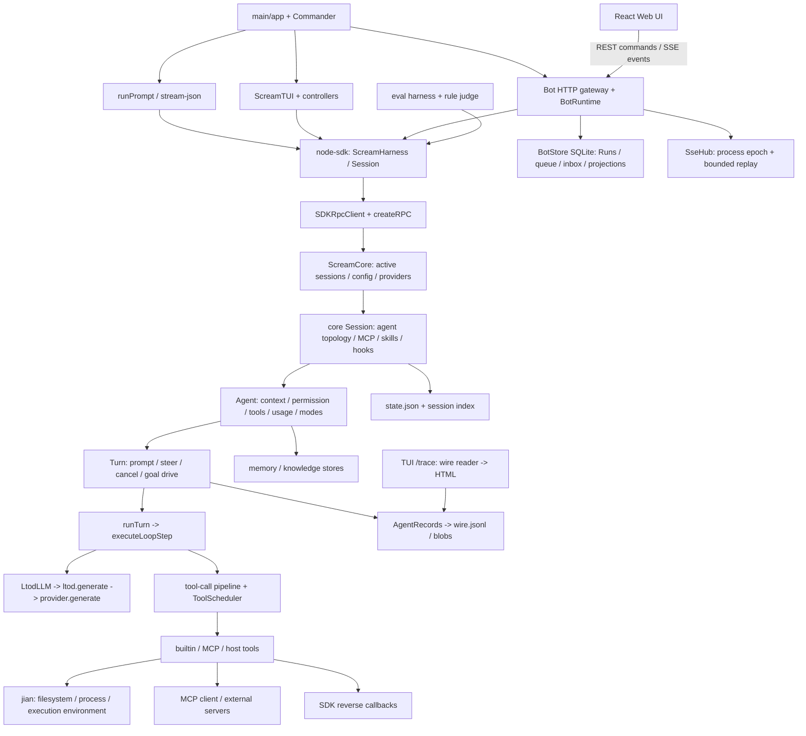

# scream-code：模块依赖与多入口共享后端机制

## 0. 研究基线、方法与结论

- 研究日期：2026-10-27。研究票：[研究 scream-code：模块依赖与多入口共享后端机制](https://github.com/yyyac/harness/issues/2)。
- 外部源：`https://github.com/LIUTod/scream-code.git`；`gh repo view` 确认默认分支 `main`，shallow clone 的 `origin/HEAD -> origin/main`，固定 HEAD **`3d48608f9b4839e366749cf1c70f6719fd1e3039`**（提交时间 2026-10-25T12:34:54+08:00，`chore(release): bump packages to 0.19.1`）。以下源码链接均固定此 commit，不使用浮动 main。
- 方法：后台 investigator 静态阅读真实入口、SDK/RPC、Agent/Turn/loop、LLM、工具分发与 Write、session/records、Bot gateway/store/runtime、trace/evals 及相关测试。没有运行源项目程序、安装依赖、调用模型、打开浏览器或执行 kill 实验；**测试“存在/断言某行为”不等于本研究已运行通过，更不等于验证了 kill 恢复**。
- 本执行线程首次 `Skill('research')` 因同名歧义失败后直接读取 skill；协调器已成功加载 research，确认本线程即后台 investigator。研究只在专属 research worktree 生成此报告，不改 main、其他研究分支或父 map。

**核心判断**：适合借鉴的是“SDK 门面 + 可注入的无状态 step/turn loop + backend-owned session + 结构化事件 + Web 外层保守恢复门禁”。不应借鉴成“同一持久 daemon 默认被所有入口共享”，更不能称作“任意工具副作用可精确续跑/恰好一次”。后两点均不受本次源码证据支持。

## 1. 模块图：箭头为直接调用、持有或导入，不是所有权继承

### 1.1 职责及直接依赖（区别运行时导入与 manifest 分类）

| 模块 | 真实职责与直接依赖 | 固定源码证据 |
|---|---|---|
| `apps/scream-code` | Commander 路由 CLI；pi-tui 控制器负责终端交互；React/TanStack 负责 Web；Hono 提供 HTTP/SSE。CLI/TUI/Bot 均调用 node-sdk，而不是各实现一个模型工具循环。 | [app 路由 L17–52](https://github.com/LIUTod/scream-code/blob/3d48608f9b4839e366749cf1c70f6719fd1e3039/apps/scream-code/src/app.ts#L17-L52)、[app 外部依赖 L60–87](https://github.com/LIUTod/scream-code/blob/3d48608f9b4839e366749cf1c70f6719fd1e3039/apps/scream-code/package.json#L60-L87) |
| `node-sdk` | `ScreamHarness` 管会话门面；`Session` 携带 ID 并过滤事件；`SDKRpcClient` 直接创建 core，提供审批、问答、host tool 回调。直接导入 agent-core/config；manifest 把四个内部包放在 devDependencies，不能只按 dependencies 推断不存在耦合。 | [构造 L42–64](https://github.com/LIUTod/scream-code/blob/3d48608f9b4839e366749cf1c70f6719fd1e3039/packages/node-sdk/src/scream-harness.ts#L42-L64)、[RPC 创建 L192–210](https://github.com/LIUTod/scream-code/blob/3d48608f9b4839e366749cf1c70f6719fd1e3039/packages/node-sdk/src/rpc.ts#L192-L210)、[manifest L36–47](https://github.com/LIUTod/scream-code/blob/3d48608f9b4839e366749cf1c70f6719fd1e3039/packages/node-sdk/package.json#L36-L47) |
| `ScreamCore` / core `Session` | core 持有活跃 Session map、配置、session store、插件、LSP supervisor；Session 注入 jian/provider/RPC，持有 agent 拓扑、MCP/skills/hooks，而非 UI 持有这些真状态。 | [core L222–274](https://github.com/LIUTod/scream-code/blob/3d48608f9b4839e366749cf1c70f6719fd1e3039/packages/agent-core/src/rpc/core-impl.ts#L222-L274)、[会话装配 L350–369](https://github.com/LIUTod/scream-code/blob/3d48608f9b4839e366749cf1c70f6719fd1e3039/packages/agent-core/src/rpc/core-impl.ts#L350-L369)、[Agent 注入 L834–870](https://github.com/LIUTod/scream-code/blob/3d48608f9b4839e366749cf1c70f6719fd1e3039/packages/agent-core/src/session/index.ts#L834-L870) |
| `agent/turn` 与 `loop/` | Turn 承担持久上下文/模式/预算/权限的 host 编排；loop 本身只依赖 `LLM`、消息 builder、工具表、hooks、event dispatcher 和 signal。不是 loop 直接访问 session DB。 | [RunTurnInput L40–74](https://github.com/LIUTod/scream-code/blob/3d48608f9b4839e366749cf1c70f6719fd1e3039/packages/agent-core/src/loop/run-turn.ts#L40-L74)、[host 注入 L703–731](https://github.com/LIUTod/scream-code/blob/3d48608f9b4839e366749cf1c70f6719fd1e3039/packages/agent-core/src/agent/turn/index.ts#L703-L731) |
| `agent/tool` / `tools` / `mcp` | 注册表合并 host user/MCP/builtin；builtin Write、Edit、Read、Bash 直接依赖 Jian；loop 管 preflight/authorize/schedule/finalize，不把权限散落各入口。 | [工具表 L1077–1104](https://github.com/LIUTod/scream-code/blob/3d48608f9b4839e366749cf1c70f6719fd1e3039/packages/agent-core/src/agent/tool/index.ts#L1077-L1104)、[builtin 装配 L1225–1236](https://github.com/LIUTod/scream-code/blob/3d48608f9b4839e366749cf1c70f6719fd1e3039/packages/agent-core/src/agent/tool/index.ts#L1225-L1236) |
| `ltod` | 模型/provider 协议、生成流、消息/工具/usage 归一化；core 的 LtodLLM 将流适配到 loop 的 `LLM` 接口。 | [LLM 合同 L42–85](https://github.com/LIUTod/scream-code/blob/3d48608f9b4839e366749cf1c70f6719fd1e3039/packages/agent-core/src/loop/llm.ts#L42-L85)、[适配 L134–157](https://github.com/LIUTod/scream-code/blob/3d48608f9b4839e366749cf1c70f6719fd1e3039/packages/agent-core/src/agent/turn/ltod-llm.ts#L134-L157)、[provider 调用 L113–145](https://github.com/LIUTod/scream-code/blob/3d48608f9b4839e366749cf1c70f6719fd1e3039/packages/ltod/src/generate.ts#L113-L145) |
| `records` / context | records 序列化与回放；context 维护 history/openSteps/pendingToolResultIds、压缩快照及 provider 投影；媒体 blob 另存。 | [context snapshot L136–179](https://github.com/LIUTod/scream-code/blob/3d48608f9b4839e366749cf1c70f6719fd1e3039/packages/agent-core/src/agent/context/index.ts#L136-L179)、[blob 合同 L23–29](https://github.com/LIUTod/scream-code/blob/3d48608f9b4839e366749cf1c70f6719fd1e3039/packages/agent-core/src/agent/records/blobref.ts#L23-L29) |
| memory / knowledge / config | memory/knowledge 是额外跨会话能力，并非 Run journal；core manifest 直接依赖 jian/knowledge/ltod/memory，knowledge 又依赖 memory；SDK/app 使用独立 config 包。 | [core 依赖 L45–71](https://github.com/LIUTod/scream-code/blob/3d48608f9b4839e366749cf1c70f6719fd1e3039/packages/agent-core/package.json#L45-L71)、[knowledge 依赖 L40–48](https://github.com/LIUTod/scream-code/blob/3d48608f9b4839e366749cf1c70f6719fd1e3039/packages/knowledge/package.json#L40-L48)、[SDK 导入 L1–15](https://github.com/LIUTod/scream-code/blob/3d48608f9b4839e366749cf1c70f6719fd1e3039/packages/node-sdk/src/scream-harness.ts#L1-L15) |

上述是关键直接依赖切面，不是全 npm 依赖清单。架构约定声称 app 核心能力只经 SDK、core 不依赖 app；源码入口与此一致，但 app manifest 确实同时声明 agent-core 等内部 devDependencies，不宜把“源码调用边界”误写成“包依赖图上完全没有边”。[约定 L48–68](https://github.com/LIUTod/scream-code/blob/3d48608f9b4839e366749cf1c70f6719fd1e3039/AGENTS.md#L48-L68)、[manifest L89–97](https://github.com/LIUTod/scream-code/blob/3d48608f9b4839e366749cf1c70f6719fd1e3039/apps/scream-code/package.json#L89-L97)。

## 2. CLI / TUI / Web 的真正入口及共享边界

1. **已发布命令**：`scream -> dist/main.mjs`；源码 `main.ts` 动态 import `app.js` 并调用 `main()`，app 建 Commander 后 `parse(process.argv)`。[bin L25–29](https://github.com/LIUTod/scream-code/blob/3d48608f9b4839e366749cf1c70f6719fd1e3039/apps/scream-code/package.json#L25-L29)、[源码入口 L9–17](https://github.com/LIUTod/scream-code/blob/3d48608f9b4839e366749cf1c70f6719fd1e3039/apps/scream-code/src/main.ts#L9-L17)、[注册与解析 L55–106](https://github.com/LIUTod/scream-code/blob/3d48608f9b4839e366749cf1c70f6719fd1e3039/apps/scream-code/src/app.ts#L55-L106)。
2. **非交互 CLI**：print 模式进 `runPrompt`，该路径创建 harness，创建/恢复 SDK session，先订阅事件再 prompt，文本或 JSON 是入口投影；不是 prompt 返回值就是最终回答。[路由 L47–52](https://github.com/LIUTod/scream-code/blob/3d48608f9b4839e366749cf1c70f6719fd1e3039/apps/scream-code/src/app.ts#L47-L52)、[runPrompt 构造 L45–70](https://github.com/LIUTod/scream-code/blob/3d48608f9b4839e366749cf1c70f6719fd1e3039/apps/scream-code/src/cli/run-prompt.ts#L45-L70)、[session 选择 L150–200](https://github.com/LIUTod/scream-code/blob/3d48608f9b4839e366749cf1c70f6719fd1e3039/apps/scream-code/src/cli/run-prompt.ts#L150-L200)、[订阅 L307–332](https://github.com/LIUTod/scream-code/blob/3d48608f9b4839e366749cf1c70f6719fd1e3039/apps/scream-code/src/cli/run-prompt.ts#L307-L332)、[提交 L393–401](https://github.com/LIUTod/scream-code/blob/3d48608f9b4839e366749cf1c70f6719fd1e3039/apps/scream-code/src/cli/run-prompt.ts#L393-L401)。隐藏的 `stream-json` 是 stdin/stdout 适配器（cc-connect 兼容），同样走 SDK，而不是另一个 agent engine。[命令 L107–150](https://github.com/LIUTod/scream-code/blob/3d48608f9b4839e366749cf1c70f6719fd1e3039/apps/scream-code/src/cli/commands.ts#L107-L150)、[stdin L412–440](https://github.com/LIUTod/scream-code/blob/3d48608f9b4839e366749cf1c70f6719fd1e3039/apps/scream-code/src/cli/run-stream-json.ts#L412-L440)、[prompt L960–974](https://github.com/LIUTod/scream-code/blob/3d48608f9b4839e366749cf1c70f6719fd1e3039/apps/scream-code/src/cli/run-stream-json.ts#L960-L974)。
3. **TUI**：默认 `runShell` 创建 `ScreamHarness`，装配 `ScreamTUI` 并 `start()`；输入控制器最终调用 `session.prompt`，事件处理器 `session.onEvent` 后分派。终端渲染/队列与后端会话状态是不同层。[装配 L39–55、75–84](https://github.com/LIUTod/scream-code/blob/3d48608f9b4839e366749cf1c70f6719fd1e3039/apps/scream-code/src/cli/run-shell.ts#L39-L84)、[发送 L393–413](https://github.com/LIUTod/scream-code/blob/3d48608f9b4839e366749cf1c70f6719fd1e3039/apps/scream-code/src/tui/controllers/input-controller.ts#L393-L413)、[订阅 L317–330](https://github.com/LIUTod/scream-code/blob/3d48608f9b4839e366749cf1c70f6719fd1e3039/apps/scream-code/src/tui/controllers/session-event-handler.ts#L317-L330)。
4. **Web**：`scream bot` 子命令进入 `runBot/startBotServer`；后者创建 SQLite BotStore、一个 harness、BotRuntime、SseHub、Hono listener，并从 `dist/bot-ui` 找构建产物；React `main.tsx` 是浏览器入口。Web transport 才有真正 REST/SSE 边界。[子命令 L153–183](https://github.com/LIUTod/scream-code/blob/3d48608f9b4839e366749cf1c70f6719fd1e3039/apps/scream-code/src/cli/commands.ts#L153-L183)、[网关装配 L95–162](https://github.com/LIUTod/scream-code/blob/3d48608f9b4839e366749cf1c70f6719fd1e3039/apps/scream-code/src/bot/server/index.ts#L95-L162)、[UI 寻址 L25–48](https://github.com/LIUTod/scream-code/blob/3d48608f9b4839e366749cf1c70f6719fd1e3039/apps/scream-code/src/bot/server/index.ts#L25-L48)、[React 入口 L1–26](https://github.com/LIUTod/scream-code/blob/3d48608f9b4839e366749cf1c70f6719fd1e3039/apps/scream-code/src/bot/ui/main.tsx#L1-L26)。源码另有 `bot:server` 开发入口，不能把所有 dev 启动选项等同已发布 CLI。[scripts L41–50](https://github.com/LIUTod/scream-code/blob/3d48608f9b4839e366749cf1c70f6719fd1e3039/apps/scream-code/package.json#L41-L50)。

**避免同名混淆**：`scream bot` 是 Web 工作台服务，TUI 的 `/bot` 是 unattended permission mode，不是“切换到 Web 后端”。README 明确分别描述两者；本报告不把它们当作同一个入口。[功能对照 L55–56](https://github.com/LIUTod/scream-code/blob/3d48608f9b4839e366749cf1c70f6719fd1e3039/README.md#L55-L56)。

**“共享”的精确定义**：每个 harness 构造自己的 SDKRpcClient 和 ScreamCore；`createRPC` 用双向对象绑定、`setTimeout`、JSON stringify/parse **模拟**传输。CLI/TUI 默认不经 HTTP 连接 Bot server。它们共享的是代码、协议形状和存储格式，不是默认共享一个活跃 Session 对象/同一进程。Web gateway 内，一个 harness 懒加载多个 thread 对应的 core session，已存在 `coreSessionId` 时 resume；这是 Web 内部复用。[SDK 创建 core L192–210](https://github.com/LIUTod/scream-code/blob/3d48608f9b4839e366749cf1c70f6719fd1e3039/packages/node-sdk/src/rpc.ts#L192-L210)、[模拟 RPC L31–53、116–126](https://github.com/LIUTod/scream-code/blob/3d48608f9b4839e366749cf1c70f6719fd1e3039/packages/agent-core/src/rpc/client.ts#L31-L53)、[RPC 绑定 L116–126](https://github.com/LIUTod/scream-code/blob/3d48608f9b4839e366749cf1c70f6719fd1e3039/packages/agent-core/src/rpc/client.ts#L116-L126)、[Web session factory L258–277](https://github.com/LIUTod/scream-code/blob/3d48608f9b4839e366749cf1c70f6719fd1e3039/apps/scream-code/src/bot/server/runtime.ts#L258-L277)。

## 3. 一个真实实现路径：Web 输入要求 Write 文件，直到输出事件

这是源码可连接的路径，不是本研究实际发起过的一次模型运行；模型是否选 Write 仍由生成结果决定。选 Web 是为了同时显示外层 Run 与内层 Turn 的边界；CLI/TUI 从 SDK 处汇合。

| 阶段 | 调用与边界 | 紧密证据 |
|---|---|---|
| 1. UI command | Web `prompt(threadId,input)` POST `/api/threads/:id/messages`；gateway 验证 text/mode/attachments/requestKey，`runtime.prompt` 后返回 **202**。不是等模型完成。 | [client L308–312](https://github.com/LIUTod/scream-code/blob/3d48608f9b4839e366749cf1c70f6719fd1e3039/apps/scream-code/src/bot/ui/lib/api/http-client.ts#L308-L312)、[gateway L579–604](https://github.com/LIUTod/scream-code/blob/3d48608f9b4839e366749cf1c70f6719fd1e3039/apps/scream-code/src/bot/server/gateway.ts#L579-L604) |
| 2. 接受输入 | BotRuntime 检查 persisted requestKey；事务中创建 Run、记录输入/用户消息、touch thread。活跃时可 steer，否则排队。 | [runtime L404–449](https://github.com/LIUTod/scream-code/blob/3d48608f9b4839e366749cf1c70f6719fd1e3039/apps/scream-code/src/bot/server/runtime.ts#L404-L449) |
| 3. 派发与完成等待 | `executeRun` ensureSession/applyConfig；安装 waiter，**markDispatch 后 session.prompt(text)**，再等 `ended`。Run 不是 SDK prompt 的返回结果。 | [runtime L810–835](https://github.com/LIUTod/scream-code/blob/3d48608f9b4839e366749cf1c70f6719fd1e3039/apps/scream-code/src/bot/server/runtime.ts#L810-L835) |
| 4. SDK 到 Agent | SDK Session normalize 输入；RPC 加 sessionId/agentId；core `prompt -> sessionApi.prompt -> agent.rpcMethods.prompt -> turn.prompt`。 | [SDK Session L105–111](https://github.com/LIUTod/scream-code/blob/3d48608f9b4839e366749cf1c70f6719fd1e3039/packages/node-sdk/src/session.ts#L105-L111)、[SDK RPC L302–309](https://github.com/LIUTod/scream-code/blob/3d48608f9b4839e366749cf1c70f6719fd1e3039/packages/node-sdk/src/rpc.ts#L302-L309)、[core L620–622](https://github.com/LIUTod/scream-code/blob/3d48608f9b4839e366749cf1c70f6719fd1e3039/packages/agent-core/src/rpc/core-impl.ts#L620-L622)、[session RPC L140–144](https://github.com/LIUTod/scream-code/blob/3d48608f9b4839e366749cf1c70f6719fd1e3039/packages/agent-core/src/session/rpc.ts#L140-L144)、[Agent L810–817](https://github.com/LIUTod/scream-code/blob/3d48608f9b4839e366749cf1c70f6719fd1e3039/packages/agent-core/src/agent/index.ts#L810-L817) |
| 5. 后端 Turn | `prompt` 记录 `turn.prompt`；空闲 allocate turn ID、AbortController，后台 turnWorker；忙时加入 steerBuffer。runOneTurn 发 `turn.started`、appendUserMessage，调用 host runTurn。 | [prompt L142–163](https://github.com/LIUTod/scream-code/blob/3d48608f9b4839e366749cf1c70f6719fd1e3039/packages/agent-core/src/agent/turn/index.ts#L142-L163)、[launch L213–221](https://github.com/LIUTod/scream-code/blob/3d48608f9b4839e366749cf1c70f6719fd1e3039/packages/agent-core/src/agent/turn/index.ts#L213-L221)、[runOneTurn L518–549](https://github.com/LIUTod/scream-code/blob/3d48608f9b4839e366749cf1c70f6719fd1e3039/packages/agent-core/src/agent/turn/index.ts#L518-L549) |
| 6. loop/model | host 提供 `agent.llm`、`context.messagesForLLM`、dispatch 和动态工具表。loop 每步 build messages/tools，`chatWithRetry`；LtodLLM 将 params 交 ltod.generate，后者 `provider.generate` 后消费流。 | [host L708–725](https://github.com/LIUTod/scream-code/blob/3d48608f9b4839e366749cf1c70f6719fd1e3039/packages/agent-core/src/agent/turn/index.ts#L708-L725)、[step L108–173](https://github.com/LIUTod/scream-code/blob/3d48608f9b4839e366749cf1c70f6719fd1e3039/packages/agent-core/src/loop/turn-step.ts#L108-L173)、[LLM 构造 L632–648](https://github.com/LIUTod/scream-code/blob/3d48608f9b4839e366749cf1c70f6719fd1e3039/packages/agent-core/src/agent/index.ts#L632-L648)、[ltod.generate L121–145](https://github.com/LIUTod/scream-code/blob/3d48608f9b4839e366749cf1c70f6719fd1e3039/packages/ltod/src/generate.ts#L121-L145) |
| 7. model -> tool | 只有归一化 stopReason 为 `tool_use` 才执行 batch，截断的调用只配 synthetic error、不执行。工具经参数校验、resolveExecution、authorize；dispatch `tool.call` 后交 scheduler。权限由 host hook 接 `agent.permission.beforeToolCall`。 | [step L245–268](https://github.com/LIUTod/scream-code/blob/3d48608f9b4839e366749cf1c70f6719fd1e3039/packages/agent-core/src/loop/turn-step.ts#L245-L268)、[prepare L683–749](https://github.com/LIUTod/scream-code/blob/3d48608f9b4839e366749cf1c70f6719fd1e3039/packages/agent-core/src/loop/tool-call.ts#L683-L749)、[authorize hook L1086–1088](https://github.com/LIUTod/scream-code/blob/3d48608f9b4839e366749cf1c70f6719fd1e3039/packages/agent-core/src/agent/turn/index.ts#L1086-L1088) |
| 8. Write 副作用 | Write resolve 路径策略、声明 writeFile resource/access 与 approval rule，执行时同路径 mutation lock；`jian.writeText` 真写文件后还 await LSP diagnostics 才返回结果。因此“写已完成，结果未生成/持久化”的窗口在实现中真实存在。 | [Write L90–111](https://github.com/LIUTod/scream-code/blob/3d48608f9b4839e366749cf1c70f6719fd1e3039/packages/agent-core/src/tools/builtin/file/write.ts#L90-L111)、[写入到返回 L138–170](https://github.com/LIUTod/scream-code/blob/3d48608f9b4839e366749cf1c70f6719fd1e3039/packages/agent-core/src/tools/builtin/file/write.ts#L138-L170) |
| 9. tool -> 下一步 | scheduler 允许不冲突资源并发、冲突串行；batch 按 provider 顺序 finalize 并 dispatch `tool.result`。context 将结果入 history、清 pending ID；loop 遇 tool_use 继续模型下一步，否则收敛。 | [scheduler L32–61](https://github.com/LIUTod/scream-code/blob/3d48608f9b4839e366749cf1c70f6719fd1e3039/packages/agent-core/src/loop/tool-scheduler.ts#L32-L61)、[结果 L421–452](https://github.com/LIUTod/scream-code/blob/3d48608f9b4839e366749cf1c70f6719fd1e3039/packages/agent-core/src/loop/tool-call.ts#L421-L452)、[context L720–741](https://github.com/LIUTod/scream-code/blob/3d48608f9b4839e366749cf1c70f6719fd1e3039/packages/agent-core/src/agent/context/index.ts#L720-L741)、[收敛 L182–203](https://github.com/LIUTod/scream-code/blob/3d48608f9b4839e366749cf1c70f6719fd1e3039/packages/agent-core/src/loop/run-turn.ts#L182-L203) |
| 10. 输出事件 | Turn dispatcher 先 appendTranscriptRecord 再 mapLoopEvent/emit；SDK ClientAPI 转 receiveEvent，Session 按 sessionId 过滤；Web 根据 generation+turnId 匹配 Run，投影 assistant.delta/tool.updated，`turn.ended` 才 finishRun；SSE `/api/events` 发出。 | [dispatcher L1298–1308](https://github.com/LIUTod/scream-code/blob/3d48608f9b4839e366749cf1c70f6719fd1e3039/packages/agent-core/src/agent/turn/index.ts#L1298-L1308)、[SDK 接收 L839–853](https://github.com/LIUTod/scream-code/blob/3d48608f9b4839e366749cf1c70f6719fd1e3039/packages/node-sdk/src/rpc.ts#L839-L853)、[Session 过滤 L81–92](https://github.com/LIUTod/scream-code/blob/3d48608f9b4839e366749cf1c70f6719fd1e3039/packages/node-sdk/src/session.ts#L81-L92)、[Run 绑定 L1475–1522](https://github.com/LIUTod/scream-code/blob/3d48608f9b4839e366749cf1c70f6719fd1e3039/apps/scream-code/src/bot/server/runtime.ts#L1475-L1522)、[工具及终结 L1567–1594](https://github.com/LIUTod/scream-code/blob/3d48608f9b4839e366749cf1c70f6719fd1e3039/apps/scream-code/src/bot/server/runtime.ts#L1567-L1594)、[SSE route L777–795](https://github.com/LIUTod/scream-code/blob/3d48608f9b4839e366749cf1c70f6719fd1e3039/apps/scream-code/src/bot/server/gateway.ts#L777-L795) |

**输入/输出边界**：输入是 prompt/steer/cancel 等命令及其 ack；输出是有 sessionId/agentId/turnId 的异步事件。审批/问答/host tool 是反向 RPC，不应绕过后端权限。未注册 approval handler 返回 cancelled，host tool handler 缺失返回 error。[反向处理 L940–999](https://github.com/LIUTod/scream-code/blob/3d48608f9b4839e366749cf1c70f6719fd1e3039/packages/node-sdk/src/rpc.ts#L940-L999)。

## 4. 状态所有权：Session ≠ Turn ≠ Web Run ≠ Checkpoint ≠ Trace

| 概念 | 所有者与持久边界 | 注意 |
|---|---|---|
| Session | ScreamCore 的 sessions map 持有活跃 core Session；Session 持有 metadata.agents 拓扑、MCP/skills/hooks/subagent message bus。`state.json` 原子写入，会话目录与 index 由 SessionStore 建立。 | SDK Session 是门面，不是核心状态所有者；UI 另有 projection。证据：[core map](https://github.com/LIUTod/scream-code/blob/3d48608f9b4839e366749cf1c70f6719fd1e3039/packages/agent-core/src/rpc/core-impl.ts#L222-L239)、[metadata L591–611](https://github.com/LIUTod/scream-code/blob/3d48608f9b4839e366749cf1c70f6719fd1e3039/packages/agent-core/src/session/index.ts#L591-L611)、[index L70–93](https://github.com/LIUTod/scream-code/blob/3d48608f9b4839e366749cf1c70f6719fd1e3039/packages/agent-core/src/session/store/session-store.ts#L70-L93)。 |
| Agent / Turn | 每个 Agent 有自己的 context/tools/permission/usage/records；Turn 的 activeTurn/controller/promise/steerBuffer 是活进程控制状态，日志保存 prompt/steer/cancel 与 transcript 等可回放状态。 | 主 Agent、子 Agent 分开持久；`resume()` 回放后 load/reconcile background、cron 并 finishResume，不重新执行死去的 turn。[Agent resume L766–773](https://github.com/LIUTod/scream-code/blob/3d48608f9b4839e366749cf1c70f6719fd1e3039/packages/agent-core/src/agent/index.ts#L766-L773)、[Turn 控制 L213–239](https://github.com/LIUTod/scream-code/blob/3d48608f9b4839e366749cf1c70f6719fd1e3039/packages/agent-core/src/agent/turn/index.ts#L213-L239)。 |
| Run | Web BotStore 的独立 durable orchestration entity，保存输入/requestKey、status、dispatch marker、coreSessionId/sessionGeneration/turnId 和 recovery decision；BotRuntime 的 maps 是其进程内执行索引。 | 不是 core 全局通用 Run API；一次 SDK prompt/一个 goal-driven drive 可伴随多次 turn.started，Web 还会生成 observed run，不能强行与 Turn 一一同名。[绑定 L1479–1496](https://github.com/LIUTod/scream-code/blob/3d48608f9b4839e366749cf1c70f6719fd1e3039/apps/scream-code/src/bot/server/runtime.ts#L1479-L1496)、[持久标记 L1157–1188](https://github.com/LIUTod/scream-code/blob/3d48608f9b4839e366749cf1c70f6719fd1e3039/apps/scream-code/src/bot/server/store.ts#L1157-L1188)。 |
| Checkpoint 类状态 | core 使用 `context.snapshot`：压缩后保存 context history、openSteps、pending IDs、deferred messages、edits 等；每 Agent `wire.jsonl` 是记录，blobs 单独存；state.json 是拓扑 metadata。 | 这是 context checkpoint，不是文件系统/外部工具/OS process checkpoint。Web SSE snapshot 是另一种 UI 同步 checkpoint。证据：[snapshot 写 L388–398](https://github.com/LIUTod/scream-code/blob/3d48608f9b4839e366749cf1c70f6719fd1e3039/packages/agent-core/src/agent/context/index.ts#L388-L398)、[snapshot 内容 L161–179](https://github.com/LIUTod/scream-code/blob/3d48608f9b4839e366749cf1c70f6719fd1e3039/packages/agent-core/src/agent/context/index.ts#L161-L179)、[wire/blob 路径 L250–266](https://github.com/LIUTod/scream-code/blob/3d48608f9b4839e366749cf1c70f6719fd1e3039/packages/agent-core/src/agent/index.ts#L250-L266)。 |
| Trace | TUI `/trace` 读取当前 session 的 `agents/main/wire.jsonl`，生成临时 HTML；wire 的 request.header/loop records 是源数据；不是 trace 管理执行状态。 | 不自动覆盖所有子 Agent；不等同 Run journal，也不是可完整重放 provider request 的无损独立工件。[trace L22–47](https://github.com/LIUTod/scream-code/blob/3d48608f9b4839e366749cf1c70f6719fd1e3039/apps/scream-code/src/tui/commands/trace.ts#L22-L47)。 |
| SSE cursor | SseHub 持有 process epoch、全局 seq 和默认 500 条环形 replay；重启 epoch 变化或 gap 时发 resync。 | DB 才是 durable state；不能拿 SSE seq 当跨进程日志 offset。[buffer L1–8、52–70](https://github.com/LIUTod/scream-code/blob/3d48608f9b4839e366749cf1c70f6719fd1e3039/apps/scream-code/src/bot/server/sse.ts#L1-L8)、[cursor 验证 L145–165](https://github.com/LIUTod/scream-code/blob/3d48608f9b4839e366749cf1c70f6719fd1e3039/apps/scream-code/src/bot/server/sse.ts#L145-L165)。 |

## 5. kill / 恢复：可证明什么，不能证明什么

### 5.1 已实现的防损坏与回放

- Session metadata 用 `writeTextAtomic`，wire rewrite 用临时文件 + sync + rename + directory sync；普通 append 批次写后 `fh.sync()`。这降低截断/重写破坏风险，不构成跨 metadata、wire、Bot SQLite、外部副作用的联合事务。[metadata L595–611](https://github.com/LIUTod/scream-code/blob/3d48608f9b4839e366749cf1c70f6719fd1e3039/packages/agent-core/src/session/index.ts#L595-L611)、[wire L710–753](https://github.com/LIUTod/scream-code/blob/3d48608f9b4839e366749cf1c70f6719fd1e3039/packages/agent-core/src/agent/records/persistence.ts#L710-L753)。
- 回放恢复记录状态，不再次触发模型/工具；同版本从最后 context snapshot 跳过已折叠上下文，并在阈值后 reclaim 旧 wire；流式草稿 `context.stream_draft` 只恢复 UI partial，不加入模型上下文。[restore 合同 L24–26](https://github.com/LIUTod/scream-code/blob/3d48608f9b4839e366749cf1c70f6719fd1e3039/packages/agent-core/src/agent/records/index.ts#L24-L26)、[draft restore L137–147](https://github.com/LIUTod/scream-code/blob/3d48608f9b4839e366749cf1c70f6719fd1e3039/packages/agent-core/src/agent/records/index.ts#L137-L147)、[reclaim L340–363](https://github.com/LIUTod/scream-code/blob/3d48608f9b4839e366749cf1c70f6719fd1e3039/packages/agent-core/src/agent/records/index.ts#L340-L363)。回放并非一切磁盘写都禁止：例如压缩 memo 恢复显式做幂等补存，后台 reconcile 也另有生命周期，不能把“不会重跑工具”泛化成“完全无恢复副作用”。[memo 恢复 L155–164](https://github.com/LIUTod/scream-code/blob/3d48608f9b4839e366749cf1c70f6719fd1e3039/packages/agent-core/src/agent/records/index.ts#L155-L164)。
- 读 wire 容忍截断尾行；未完成 stream 保留最后完整 draft。相应测试手工构造 torn line，而非真实 SIGKILL/掉电。[reader L391–420](https://github.com/LIUTod/scream-code/blob/3d48608f9b4839e366749cf1c70f6719fd1e3039/packages/agent-core/src/agent/records/persistence.ts#L391-L420)、[测试 L302–322](https://github.com/LIUTod/scream-code/blob/3d48608f9b4839e366749cf1c70f6719fd1e3039/packages/agent-core/test/agent/records/wire-reclaim.test.ts#L302-L322)。

### 5.2 最重要的副作用不确定窗口

| kill 时点 | 按源码推导的保守解释 |
|---|---|
| Web 已接受入 DB，尚无 dispatch marker | 完整 queued input 可在重启后进入队列；这不是重跑已执行工具。 |
| markDispatch 已存，但还没真正 prompt/执行 | Web 仍视结果不确定，标 interrupted 并 gate；宁可人工确认，不自动补发。 |
| 工具已执行、结果尚未生成/dispatch/落盘 | Write 已写文件后还 await diagnostics；Bash/远端 MCP 同样可能已有外部效果。wire 可能只有 call，甚至 call 也尚未 fsync；不能由“缺 result”推断“未执行”。 |
| 工具结果只在内存/已发 live 但未完成 fsync | 下次磁盘历史可能落后于用户见过的输出；不能将 live event ack 视作 durability ack。 |
| result 已 durable，但 Web Run 尚未来得及终结 | core 可能恢复到有结果的上下文，Web 仍会 conservative interrupted；两套存储不是同一事务。 |

证据链必须整体阅读：dispatcher 虽 `await appendTranscriptRecord` 后发 live，但 Turn 的 callback 只调用同步 `context.appendLoopEvent -> records.logRecord -> persistence.append`；`append` 只是 `pendingRecords.push + scheduleFlush()`，没有 await fsync。执行路径 `dispatchToolCall -> scheduler -> execution.execute` 未等待 `records.flush`。因此这里有**逻辑 append-before-execute**，没有从调用链证明的 **durable intent-before-side-effect**。[event seam L208–213](https://github.com/LIUTod/scream-code/blob/3d48608f9b4839e366749cf1c70f6719fd1e3039/packages/agent-core/src/loop/events.ts#L208-L213)、[Turn callback L1298–1306](https://github.com/LIUTod/scream-code/blob/3d48608f9b4839e366749cf1c70f6719fd1e3039/packages/agent-core/src/agent/turn/index.ts#L1298-L1306)、[记录 L220–239](https://github.com/LIUTod/scream-code/blob/3d48608f9b4839e366749cf1c70f6719fd1e3039/packages/agent-core/src/agent/records/index.ts#L220-L239)、[async append/flush L627–665](https://github.com/LIUTod/scream-code/blob/3d48608f9b4839e366749cf1c70f6719fd1e3039/packages/agent-core/src/agent/records/persistence.ts#L627-L665)、[execution L741–748](https://github.com/LIUTod/scream-code/blob/3d48608f9b4839e366749cf1c70f6719fd1e3039/packages/agent-core/src/loop/tool-call.ts#L741-L748)。以上是静态风险分析，未执行 crash 注入，不能据此量化丢失概率或声称实测失败。

**悬空工具交换不是重跑**：live turn teardown 会合成 error result 关闭 pending；hard kill 不会经过该 teardown。`finishResume` 明确不补写 abandoned exchange；但 `messagesForLLM` 投影设置 `synthesizeMissing:true`，补 provider 可接受的错误工具消息，文案要求“不要假设成功/不要捏造结果”。这修复消息协议，不查外部效果，不续跑旧 call，也不是 rollback。[live 修复 L586–611](https://github.com/LIUTod/scream-code/blob/3d48608f9b4839e366749cf1c70f6719fd1e3039/packages/agent-core/src/agent/turn/index.ts#L586-L611)、[resume L326–335](https://github.com/LIUTod/scream-code/blob/3d48608f9b4839e366749cf1c70f6719fd1e3039/packages/agent-core/src/agent/turn/index.ts#L326-L335)、[provider 投影 L578–596](https://github.com/LIUTod/scream-code/blob/3d48608f9b4839e366749cf1c70f6719fd1e3039/packages/agent-core/src/agent/context/index.ts#L578-L596)、[synthetic 文案与合同 L6–18、40–48](https://github.com/LIUTod/scream-code/blob/3d48608f9b4839e366749cf1c70f6719fd1e3039/packages/agent-core/src/agent/context/projector.ts#L6-L18)。

**取消也不是撤销**：工具忽略 AbortSignal 时，grace timeout 可让 loop 以 synthetic abort 继续结束，但 `Promise.race` 本身没有撤销既成副作用。[执行/grace L1002–1061](https://github.com/LIUTod/scream-code/blob/3d48608f9b4839e366749cf1c70f6719fd1e3039/packages/agent-core/src/loop/tool-call.ts#L1002-L1061)。去重器在每次 host runTurn 内新建，same-step/result cache 不等于跨 kill 的工具执行账本。[deduper L677–683](https://github.com/LIUTod/scream-code/blob/3d48608f9b4839e366749cf1c70f6719fd1e3039/packages/agent-core/src/agent/turn/index.ts#L677-L683)、[same-step L1040–1052](https://github.com/LIUTod/scream-code/blob/3d48608f9b4839e366749cf1c70f6719fd1e3039/packages/agent-core/src/agent/turn/index.ts#L1040-L1052)。

### 5.3 Web 的保守恢复协议确有代码，不仅 README

- `start()` 调 `markOrphanRuns`，过期旧 approval/question callbacks；只允许确定未派发的完整 queued input 自动继续。[runtime L363–396](https://github.com/LIUTod/scream-code/blob/3d48608f9b4839e366749cf1c70f6719fd1e3039/apps/scream-code/src/bot/server/runtime.ts#L363-L396)。
- `markOrphanRuns` 将 running/waiting_user、无 input 或有 dispatch marker 的 queued/observed 标 `interrupted`，block 对应 thread。[store L1287–1300](https://github.com/LIUTod/scream-code/blob/3d48608f9b4839e366749cf1c70f6719fd1e3039/apps/scream-code/src/bot/server/store.ts#L1287-L1300)。
- 人为 recovery decision 有 `continue_queue` / `retry` / `cancel_queue`。retry 创建关联的新 Run，原记录仍 interrupted；相同决定幂等、冲突决定拒绝。这是“重试授权幂等”，不是外部副作用幂等。[store L1170–1188](https://github.com/LIUTod/scream-code/blob/3d48608f9b4839e366749cf1c70f6719fd1e3039/apps/scream-code/src/bot/server/store.ts#L1170-L1188)。README 本身也明确 retry 可重复副作用。[文档 L160–190](https://github.com/LIUTod/scream-code/blob/3d48608f9b4839e366749cf1c70f6719fd1e3039/apps/scream-code/src/bot/README.md#L160-L190)。
- **测试证据边界**：`recovery.test.ts` 用 fake session 工厂模拟 marker/restart、queue gate、retry/requestKey 幂等、cancel ack 不等于 completion；`resume.test.ts` 用 recording persistence/fake Jian 断言回放不启动 LLM/tools。这些是重要合同测试，不是执行真实 shell 后杀进程的端到端证明。[Web tests L12–51](https://github.com/LIUTod/scream-code/blob/3d48608f9b4839e366749cf1c70f6719fd1e3039/apps/scream-code/test/bot/server/recovery.test.ts#L12-L51)、[cancel 测试 L69–85](https://github.com/LIUTod/scream-code/blob/3d48608f9b4839e366749cf1c70f6719fd1e3039/apps/scream-code/test/bot/server/recovery.test.ts#L69-L85)、[core resume 测试 L24–39](https://github.com/LIUTod/scream-code/blob/3d48608f9b4839e366749cf1c70f6719fd1e3039/packages/agent-core/test/agent/resume.test.ts#L24-L39)。

## 6. Trace 与 eval：实际实现、测试及局限

### Trace

- README 的离线 HTML timeline 有真实实现：`/trace` 取 main wire -> `buildTraceCells` -> `renderTraceHtml` -> 固定 OS temp `scream-trace.html`。命令包含系统浏览器打开逻辑；**本研究只阅读，未执行它**。[README L59–62](https://github.com/LIUTod/scream-code/blob/3d48608f9b4839e366749cf1c70f6719fd1e3039/README.md#L59-L62)、[实现 L28–50](https://github.com/LIUTod/scream-code/blob/3d48608f9b4839e366749cf1c70f6719fd1e3039/apps/scream-code/src/tui/commands/trace.ts#L28-L50)。
- 事件有 recorded/live-only 分类；text/thinking delta、tool progress 不直接进入 transcript，完整 content/tool/step 进入记录；流式 draft 是单独补救机制。因此 wire 不是每一条原始流网络 chunk 的全量追踪。[分类 L152–167](https://github.com/LIUTod/scream-code/blob/3d48608f9b4839e366749cf1c70f6719fd1e3039/packages/agent-core/src/loop/events.ts#L152-L167)、[Ltod 完整块 L177–188](https://github.com/LIUTod/scream-code/blob/3d48608f9b4839e366749cf1c70f6719fd1e3039/packages/agent-core/src/agent/turn/ltod-llm.ts#L177-L188)、[draft sink L756–768](https://github.com/LIUTod/scream-code/blob/3d48608f9b4839e366749cf1c70f6719fd1e3039/packages/agent-core/src/agent/turn/index.ts#L756-L768)。
- trace 流式逐行 JSON 解析，跳 malformed/未知 record，按 cell 截断细节（默认 4000 字符）、保留最近 4000 cells 并折叠旧部。这适合诊断浏览，不是无损审计/精确请求重放格式。[parser L542–562](https://github.com/LIUTod/scream-code/blob/3d48608f9b4839e366749cf1c70f6719fd1e3039/apps/scream-code/src/utils/trace/trace-builder.ts#L542-L562)、[caps L472–516](https://github.com/LIUTod/scream-code/blob/3d48608f9b4839e366749cf1c70f6719fd1e3039/apps/scream-code/src/utils/trace/trace-builder.ts#L472-L516)。
- **静态可见缺口 1**：producer `request.header.activeTools` 写 `string[]`，trace reader 却 `asRecordArray(...).map(t.name)`，会漏掉真实新 header 的工具列表；测试 fixture 恰好用对象数组，没覆盖生产格式。这不是运行时复现结论，但 producer/consumer schema 不一致可直接从源确认。[producer L711–719](https://github.com/LIUTod/scream-code/blob/3d48608f9b4839e366749cf1c70f6719fd1e3039/packages/agent-core/src/agent/index.ts#L711-L719)、[consumer L369–380](https://github.com/LIUTod/scream-code/blob/3d48608f9b4839e366749cf1c70f6719fd1e3039/apps/scream-code/src/utils/trace/trace-builder.ts#L369-L380)、[fixture L31–44](https://github.com/LIUTod/scream-code/blob/3d48608f9b4839e366749cf1c70f6719fd1e3039/apps/scream-code/test/utils/trace/trace-builder.test.ts#L31-L44)。
- **静态可见缺口 2**：trace switch 没有 `context.snapshot` / stream_draft 恢复分支，也不调用 core replay。core reclaim 会物理删去 snapshot 前 folded context/request.header，故不能保证压缩回收后还可完整展示早期内容。[trace 主 switch L315–324](https://github.com/LIUTod/scream-code/blob/3d48608f9b4839e366749cf1c70f6719fd1e3039/apps/scream-code/src/utils/trace/trace-builder.ts#L315-L324)、[switch 尾部 L425–469](https://github.com/LIUTod/scream-code/blob/3d48608f9b4839e366749cf1c70f6719fd1e3039/apps/scream-code/src/utils/trace/trace-builder.ts#L425-L469)、[fold 集合 L20–35](https://github.com/LIUTod/scream-code/blob/3d48608f9b4839e366749cf1c70f6719fd1e3039/packages/agent-core/src/agent/records/persistence.ts#L20-L35)。
- 测试确实覆盖 trace cells 的 thinking/tool/usage/timing、HTML 自包含与 script tag 转义；这些是生成器/呈现合同，不代表跨压缩/全子 Agent trace 完整性。[builder 测试 L48–83](https://github.com/LIUTod/scream-code/blob/3d48608f9b4839e366749cf1c70f6719fd1e3039/apps/scream-code/test/utils/trace/trace-builder.test.ts#L48-L83)、[HTML 测试 L19–58](https://github.com/LIUTod/scream-code/blob/3d48608f9b4839e366749cf1c70f6719fd1e3039/apps/scream-code/test/utils/trace/render-trace-html.test.ts#L19-L58)。

### Eval

- `packages/evals` 有真实 SDK end-to-end harness：新建临时 workspace，读取真实 home provider 配置（可覆写 screamHome），要求显式 model/SCREAM_EVAL_MODEL，以 `permission:'yolo'` 建 session。默认不是安全沙箱，也不是 home 全隔离；本次没有运行。[harness L74–115](https://github.com/LIUTod/scream-code/blob/3d48608f9b4839e366749cf1c70f6719fd1e3039/packages/evals/src/harness.ts#L74-L115)。
- 等待主 Agent 匹配 turn.started/ended，90 秒 timeout 时取消，并允许 caller 检查已经落地的文件；prompt ack 不算完成。[等待合同 L182–205](https://github.com/LIUTod/scream-code/blob/3d48608f9b4839e366749cf1c70f6719fd1e3039/packages/evals/src/harness.ts#L182-L205)、[事件过滤 L225–259](https://github.com/LIUTod/scream-code/blob/3d48608f9b4839e366749cf1c70f6719fd1e3039/packages/evals/src/harness.ts#L225-L259)、[文件验证 L129–142](https://github.com/LIUTod/scream-code/blob/3d48608f9b4839e366749cf1c70f6719fd1e3039/packages/evals/src/harness.ts#L129-L142)。
- TUI `/eval` 并非只有文案：它读取当前 UI model，后台调用 `runAllEvals` 并回报进度，切 session 后不把旧结果画到新会话。[命令 L44–92](https://github.com/LIUTod/scream-code/blob/3d48608f9b4839e366749cf1c70f6719fd1e3039/apps/scream-code/src/tui/commands/eval.ts#L44-L92)。
- `/eval` 的 programmatic runner 有四类 case：普通问答、读文件内容、写文件 exact content、隔离 cwd；judge 是规则函数，不是独立模型裁判。runner 按规则+extra 判 pass，`timedOut` 单列并非统一强制失败条件，不能把 passed 当“从未超时”。[cases L64–150](https://github.com/LIUTod/scream-code/blob/3d48608f9b4839e366749cf1c70f6719fd1e3039/packages/evals/src/runner.ts#L64-L150)、[判定 L190–212](https://github.com/LIUTod/scream-code/blob/3d48608f9b4839e366749cf1c70f6719fd1e3039/packages/evals/src/runner.ts#L190-L212)、[judge L17–28](https://github.com/LIUTod/scream-code/blob/3d48608f9b4839e366749cf1c70f6719fd1e3039/packages/evals/src/judge.ts#L17-L28)。
- regression eval 的 Write 确实断言文件内容和最终文本；Read case 主要断言回答包含 fixture，并不直接断言工具调用次数。另有 cold-start 小型人工 fixture 仓库的 retry owner 理解题（scheduler、rationale 正则与 usage），不是完整真实仓库 coding benchmark。[regression L21–50](https://github.com/LIUTod/scream-code/blob/3d48608f9b4839e366749cf1c70f6719fd1e3039/packages/evals/src/regression.eval.ts#L21-L50)、[cold-start L115–129](https://github.com/LIUTod/scream-code/blob/3d48608f9b4839e366749cf1c70f6719fd1e3039/packages/evals/src/cold-start.eval.ts#L115-L129)。

## 7. 证据分级：实现 / 文档声明 / 本次未找到

| 调查项 | 分级与结论 |
|---|---|
| 多入口共用 agent loop、统一权限与工具管道 | **源码已实现**，见第 2–3 节；不是只抄 README。 |
| CLI/TUI/Web 默认连同一个长驻 backend daemon | **本次未找到，入口代码反向表明各自构造 harness/core**；Web gateway 是其自身 HTTP 服务，不等于 CLI 默认远程客户端。 |
| Session 恢复、context snapshot、stream draft、原子重写 | **源码已实现，有模拟回放/截断测试**；未运行，不宣称真实 kill 后完整恢复。 |
| Web durable queue、unknown outcome 门禁与显式 retry | **README 声明且源码/合同测试可对应**；retry 不保证不重复副作用。 |
| 通用工具执行账本、跨进程 exactly-once、任意副作用 rollback | **本次在 loop/turn/records/Web recovery 未找到**；逻辑调用顺序、异步 flush 和显式 unknown outcome 与此类强保证不符。局部 requestKey / handoff / same-step 去重不替代它。 |
| Trace 离线 HTML、eval 健康检查 | **README 声明且有真实代码/测试**；trace 是有损 main wire 投影，eval 是小型实模型 smoke/regression，不是恢复认证或全面 coding 质量分数。 |
| 完整文件系统 checkpoint、杀死进程后从工具中途继续 | **本次未找到**。检索到的 checkpoint 还包括取消检查点、SQLite WAL checkpoint、SSE UI checkpoint，不能混称 agent durable execution checkpoint。 |

“未找到”范围限于此固定 commit 的相关源目录、入口、测试及文档静态检索，不作整个项目永远不具备该能力的绝对判断；也没有外推未调查的插件/远端服务保证。

## 8. 对本地 coding V0 的建议（研究判断，不替主 map 作决定）

1. **优先借鉴窄边界**：一个 SDK session command/event API，CLI/TUI/Web 只做适配；loop 只收 LLM、tools、hooks、message builder。若 V0 只有本地 CLI，可先同进程，不能为了“共享”先造 daemon。依据第 2–3 节。
2. **显式区分 ID 与所有者**：Session（长会话）、Agent（执行角色/上下文）、Turn（一次模型工具循环）、Run（接受的任务及恢复决策）分开；UI projection 不是执行真相。尤其不要将 SDK prompt resolve 当完成。依据第 3–4 节。
3. **保留安全 stop 条件**：参数校验 -> resolve/path access -> authorize -> execute -> normalize/result；限制 turn steps，预算耗尽有一次 wrap-up，避免失控工具循环；资源冲突调度可以先简化为串行，再按需要扩展。[预算 L114–159](https://github.com/LIUTod/scream-code/blob/3d48608f9b4839e366749cf1c70f6719fd1e3039/packages/agent-core/src/loop/run-turn.ts#L114-L159)、第 3 节工具管道。
4. **采用保守恢复，而非“自动继续一切”**：accepted -> dispatch_started -> finished 的外层任务状态；kill 后 unknown gate；显式 continue/retry/cancel，并提示 retry 可能重复外部效果。scream-code 的 Web 层已经提供很好的最小范例，但该逻辑不在所有 core 入口自动拥有。依据第 5.3 节。
5. **V0 需要补齐的硬缺口**：如果需求要求“执行意图先 durable”，必须在副作用前 await durable intent，完成后 durable result，并处理两者之间 unknown；对支持幂等键的外部系统传稳定 operation ID，对文件操作加可核对 before/after hash，对 Bash 不承诺可撤销。即便 durable intent 也不能单独消除“远端成功、本地没记结果”窗口。这是设计建议，不声称源已实现。
6. **可观测性与恢复日志分工**：durable journal 有 schema/version 与受控保留策略，trace 从同一标准 reader 投影并明确 loss/truncation/partial；不要复制此处 trace 手写 loose schema 导致 activeTools 不匹配、snapshot 不恢复的缺口。依据第 6 节。
7. **测试先补故障合同**：在未来获准执行时，增加真实本地进程/隔离 workspace 的 kill 注入：before dispatch、intent durable 前后、Write 已落地但 result 未记、result durable 但 Run 未结束；断言不自动重复 Bash/append、unknown gate、用户决定幂等、旧审批不可答。现有 fake/record tests 不替代这些测试。本次未运行它们。
8. **不要整包搬入 V0**：goal、wolfpack、RLM、script sandbox、知识图谱/向量记忆、插件自演进和多 Bot room 都会扩大状态/权限/恢复面；本票仅证明共享 core 结构可拆，不证明这些能力是 V0 必需。README 确有这些功能声明，[功能清单 L51–65](https://github.com/LIUTod/scream-code/blob/3d48608f9b4839e366749cf1c70f6719fd1e3039/README.md#L51-L65)，但本研究不做其效果背书。

## 9. 交付与限制

本报告为 throwaway 分支 `research/scream-code-architecture` 的研究资产；仅报告进入提交，外部 clone 不提交、不发 PR、不合并。研究答案摘要与固定源 commit 记录回研究票，父 map 由协调器汇总。

本次输出可信层级是“固定版本静态源码/测试断言 + 明示的架构推导”。没有安装、构建、运行任何源项目程序或 eval，没有测真实 provider、浏览器、多客户端并发、跨平台 fsync/rename、断电、真实 SIGKILL 后工具副作用一致性。有关恢复的陈述均不得读作已经实测验证。
